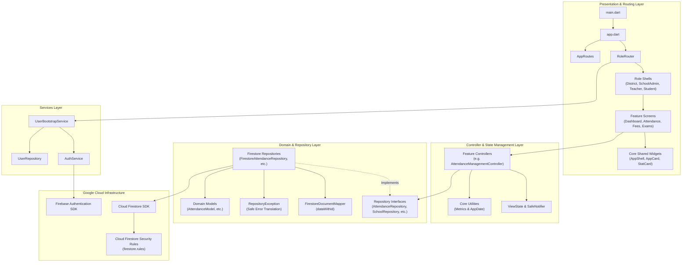
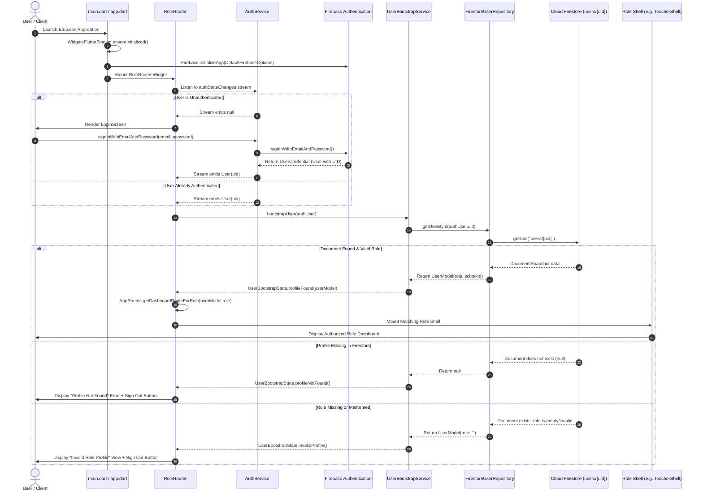
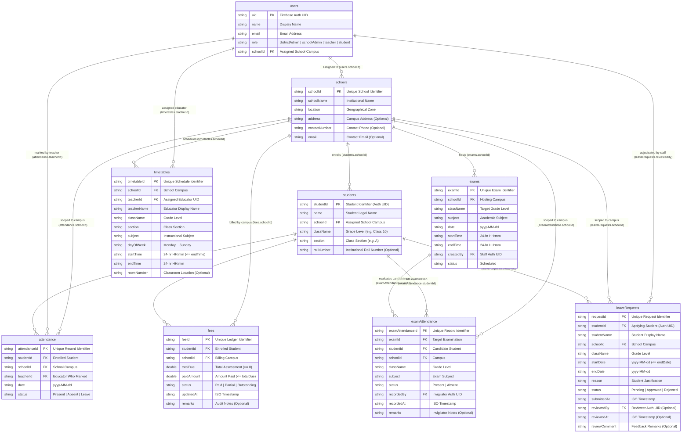
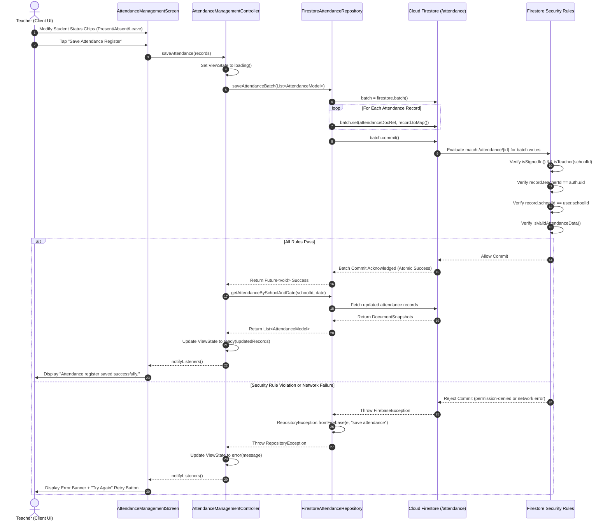
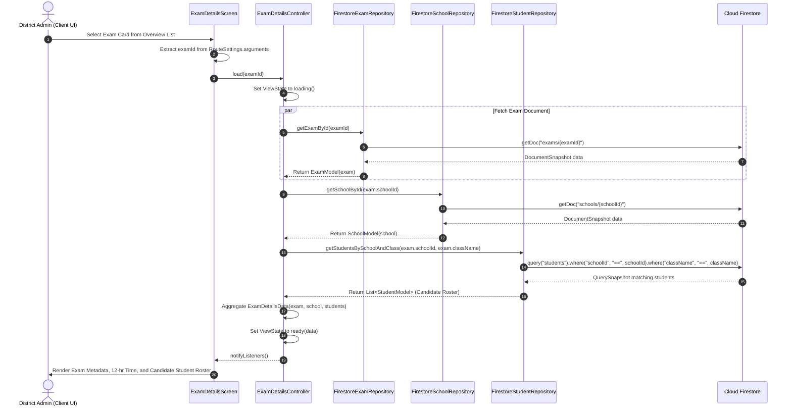

# EduLens — High-Level Design (HLD) Document

---

## Document Control

| Property | Value |
| :--- | :--- |
| **Product Name** | EduLens |
| **Document Title** | High-Level Design (HLD) Document |
| **System Category** | District & School Management System |
| **Document Version** | 2.0 (Post-MVP Architectural Baseline) |
| **Document Status** | Approved Architectural Specification |
| **Repository URL** | `https://github.com/kalviumcommunity/SW2627_Flutter_EduLens_District_School_Management_System` |
| **Target Platforms** | Android (Mobile), Web (Responsive Browser), iOS |
| **Backend Architecture** | Serverless Client-to-Database Architecture (Firebase Auth, Cloud Firestore) |
| **Date of Preparation** | November 2026 |
| **Authors & Contributors** | Lead Software Architect, Technical Documentation Engineer, Core Systems Team |
| **Intended Audience** | Enterprise Architects, Engineering Leads, Flutter Developers, Security Auditors, QA Engineers |

### Document Revision History

| Version | Date | Primary Author | Description of Architectural Changes |
| :--- | :--- | :--- | :--- |
| **1.0** | October 2026 | Architecture Team | Initial architectural draft following Day 5 data model extension and repository contract establishment. |
| **2.0** | November 2026 | Lead Architect | Comprehensive repository-grounded HLD reconciliation reflecting complete `lib/` directory layout, direct-to-database architectural boundaries, `RoleRouter` bootstrap state machine, Firestore Security Rules enforcement, and detailed sequence interactions. |

---

## Table of Contents

- [Document Control](#document-control)
- [1. Introduction](#1-introduction)
  - [1.1 Purpose of the HLD](#11-purpose-of-the-hld)
  - [1.2 System Scope](#12-system-scope)
  - [1.3 Architectural Goals](#13-architectural-goals)
  - [1.4 Relationship to PRD and LLD](#14-relationship-to-prd-and-lld)
- [2. System Overview](#2-system-overview)
  - [2.1 Product Summary](#21-product-summary)
  - [2.2 Four User Roles](#22-four-user-roles)
  - [2.3 Main Functional Modules](#23-main-functional-modules)
  - [2.4 Supported Application Platforms](#24-supported-application-platforms)
- [3. Architecture Style](#3-architecture-style)
  - [3.1 Direct-to-Database Client Architecture](#31-direct-to-database-client-architecture)
  - [3.2 Explicit Absence of an Application API Server](#32-explicit-absence-of-an-application-api-server)
  - [3.3 Layered Client Decomposition](#33-layered-client-decomposition)
- [4. System Context](#4-system-context)
  - [4.1 External Actors and External Services](#41-external-actors-and-external-services)
  - [4.2 System Context Diagram](#42-system-context-diagram)
- [5. High-Level Component Architecture](#5-high-level-component-architecture)
  - [5.1 Component Breakdown & Package Responsibilities](#51-component-breakdown--package-responsibilities)
  - [5.2 Component Interaction Diagram](#52-component-interaction-diagram)
- [6. Authentication and Role Routing Architecture](#6-authentication-and-role-routing-architecture)
  - [6.1 Ten-Step Startup & Role Resolution Sequence](#61-ten-step-startup--role-resolution-sequence)
  - [6.2 State Machine & Edge-Case Handling](#62-state-machine--edge-case-handling)
  - [6.3 Authentication & Routing Sequence Diagram](#63-authentication--routing-sequence-diagram)
- [7. Role-Based Feature Architecture](#7-role-based-feature-architecture)
  - [7.1 District Administrator Features](#71-district-administrator-features)
  - [7.2 School Administrator Features](#72-school-administrator-features)
  - [7.3 Teacher Features](#73-teacher-features)
  - [7.4 Student Features](#74-student-features)
  - [7.5 UI Navigation vs. Database Enforcement Matrix](#75-ui-navigation-vs-database-enforcement-matrix)
- [8. Data Architecture Overview](#8-data-architecture-overview)
  - [8.1 Firestore Collection Schema](#81-firestore-collection-schema)
  - [8.2 Ownership, Identity, and Partitioning](#82-ownership-identity-and-partitioning)
  - [8.3 Conceptual Document Relationship Diagram](#83-conceptual-document-relationship-diagram)
- [9. Data Flow Architecture](#9-data-flow-architecture)
  - [9.1 End-to-End Read and Write Flows](#91-end-to-end-read-and-write-flows)
  - [9.2 Attendance Batch Write Sequence Diagram](#92-attendance-batch-write-sequence-diagram)
  - [9.3 Examination Reading & Seating Allocation Sequence Diagram](#93-examination-reading--seating-allocation-sequence-diagram)
- [10. Security Architecture](#10-security-architecture)
  - [10.1 Authentication Identity vs. Profile Role](#101-authentication-identity-vs-profile-role)
  - [10.2 Server-Side Security Rules Enforcement](#102-server-side-security-rules-enforcement)
  - [10.3 School and Student Boundary Isolation](#103-school-and-student-boundary-isolation)
  - [10.4 Write Payload Schema Validation](#104-write-payload-schema-validation)
  - [10.5 UI Restrictions Are Not Security Boundaries](#105-ui-restrictions-are-not-security-boundaries)
  - [10.6 Security Verification Status & Limitations](#106-security-verification-status--limitations)
- [11. Technology Stack and Design Decisions](#11-technology-stack-and-design-decisions)
- [12. Error Handling and Resilience](#12-error-handling-and-resilience)
- [13. Deployment and Environment Architecture](#13-deployment-and-environment-architecture)
- [14. Quality Attributes](#14-quality-attributes)
- [15. Architectural Risks, Technical Debt, and Limitations](#15-architectural-risks-technical-debt-and-limitations)
- [16. Architecture Decisions Summary (ADR Table)](#16-architecture-decisions-summary-adr-table)
- [17. Glossary and References](#17-glossary-and-references)

---

## 1. Introduction

### 1.1 Purpose of the HLD
This High-Level Design (HLD) document defines the end-to-end software architecture for **EduLens**, a cross-platform District & School Management System. It articulates the structural decomposition, component interactions, security topology, data persistence model, and runtime execution patterns implemented within the repository.

### 1.2 System Scope
The scope of this design document covers the entire software system contained in the repository:
- The Flutter cross-platform client application targeting Android, Web, and iOS.
- Direct-to-database cloud persistence leveraging Google Cloud Firestore.
- Authentication and session handling via Firebase Authentication.
- Server-side authorization and multi-tenant isolation enforced through Cloud Firestore Security Rules (`firestore.rules`).
- The four operational role workflows: District Administrator, School Administrator, Teacher, and Student.
- Supporting developer utilities, including the demonstration seeder (`tool/seed_firestore.dart`) and the Firestore emulator test harnesses (`test/rules/`).

### 1.3 Architectural Goals
1. **Zero Intermediate Backend Overhead**: Eliminate the latency, maintenance cost, and serialization overhead of an intermediate custom API server by connecting the Flutter client directly to managed cloud databases.
2. **Defensive Database-Tier Security**: Guarantee that data isolation across institutions and student privacy are enforced on Google's cloud infrastructure via `firestore.rules`, ensuring that rogue or compromised clients cannot breach tenant boundaries.
3. **Decoupled Testability**: Abstract all database interactions behind abstract repository interfaces, permitting comprehensive testing of application controllers and UI widgets using in-memory fake repositories without network dependencies.
4. **Resilient Reactive Routing**: Automatically route authenticated users to their authorized operational dashboard based on trusted server-side user profiles, with robust state machine handling for unprovisioned, corrupted, or unauthenticated accounts.
5. **Algorithmic Uniformity**: Centralize derived metric computations (amount-weighted fees, rigorous attendance denominator handling, 7-day upcoming exam windows) in dedicated utility modules to eliminate presentation inconsistencies.

### 1.4 Relationship to PRD and LLD
- **PRD (`docs/PRD.md`)**: Defines *what* business problems EduLens solves, user personas, functional requirements (FR-001 through FR-032), validation rules, and feature-specific acceptance criteria.
- **HLD (`docs/HLD.md`)** *(this document)*: Defines *how* the system is structured at a macro architectural level, covering system context, component decomposition, data relationships, security boundaries, and cross-cutting design decisions.
- **LLD (`docs/LLD.md`)** *(planned companion document)*: Will define class-level method signatures, internal controller state mutators, low-level widget trees, and exact unit test assertions.

---

## 2. System Overview

### 2.1 Product Summary
EduLens is a unified management application designed to bridge the operational gap between regional education district leadership and individual school communities. It replaces fragmented paper registers, disparate spreadsheets, and delayed manual reporting with a single, synchronized, real-time platform.

### 2.2 Four User Roles
The system natively models and supports exactly four user roles:
1. **District Administrator (`districtAdmin`)**: Oversees all schools across the regional district. Accesses macro-level attendance averages, aggregated fee collection rates, district-wide exam schedules, individual school deep-dives, and automated attention threshold alerts (<70% attendance).
2. **School Administrator (`schoolAdmin`)**: Manages institutional health for an assigned school. Updates school public contact records (address, phone, email), inspects student enrollment rosters, tracks student fee settlement balances, and schedules school examinations.
3. **Teacher (`teacher`)**: Conducts daily instructional operations. Reviews today's teaching periods and weekly timetable allocations, marks daily classroom attendance registers in atomic batches, schedules class exams, and reviews/adjudicates student leave requests.
4. **Student (`student`)**: Accesses a personalized academic dashboard. Reviews personal attendance rates and categorical breakdowns (Present / Absent / Leave), inspects fee assessment dues and payment history, views school exam timetables in read-only mode, and submits formal leave applications.

### 2.3 Main Functional Modules
- **Authentication & Bootstrap**: Email/password authentication, password reset email dispatch, and profile-based dynamic routing.
- **District Governance**: Multi-school aggregation dashboard, school directory search, granular school breakdown, district exam calendar, and exam seating allocation audit.
- **School Administration**: Single-school dashboard, school directory contact editor, student roster search and class filtering, and student fee status editor with overpayment protection.
- **Teacher Operations**: Teacher home dashboard, today's period schedule, weekly timetable grid, daily attendance register marking, and student leave request adjudication.
- **Student Operations**: Personal attendance analytics, fee ledger verification, read-only exam timetable, and leave application submission dialog.
- **Shared Session Management**: Role-specific profile inspection and secure multi-stack-clearing logout across all role shells.

### 2.4 Supported Application Platforms
Based on committed platform configuration files in the repository:
- **Android**: Fully configured via `android/` with Firebase plugin bindings, Gradle build tooling, and `android/app/google-services.json`.
- **Web**: Fully configured via `web/` with responsive viewport support, HTML entrypoint, and Web Firebase configuration in `lib/firebase_options.dart`.
- **iOS**: Configured via `ios/` with CocoaPods integration and iOS Firebase bundle options in `lib/firebase_options.dart`.

---

## 3. Architecture Style

### 3.1 Direct-to-Database Client Architecture
EduLens adopts a **Serverless Direct-to-Database Architecture**. The client application, compiled from Dart source code via the Flutter framework, communicates directly with managed Google Cloud backend services over secure TLS websockets and HTTPS.

```text
┌────────────────────────────────────────────────────────────────────────┐
│                        Flutter Client Application                      │
│                                                                        │
│   UI Screens  ──►  Controllers (State)  ──►  Repository Interfaces     │
└───────────────────────────────────────────────────┬────────────────────┘
                                                    │
                                          Repository Implementations
                                                    │
                                                    ▼
┌────────────────────────────────────────────────────────────────────────┐
│                    Google Cloud Managed Services                       │
│                                                                        │
│   ┌───────────────────────────┐     ┌──────────────────────────────┐   │
│   │   Firebase Authentication │     │        Cloud Firestore       │   │
│   │  (Identity & Credentials) │     │ (Document Database & Rules)  │   │
│   └───────────────────────────┘     └──────────────────────────────┘   │
└────────────────────────────────────────────────────────────────────────┘
```

### 3.2 Explicit Absence of an Application API Server
The inspected repository contains **no custom application API server, no Node.js/Express backend, no Python/Django service, no GraphQL endpoint, and no microservices infrastructure**. 

All business logic, aggregation routines, and data transformations are executed within the Flutter client layer (`lib/core/utils/` and `lib/features/*/controllers/`), while all data validation, access authorization, and multi-tenant isolation rules are executed within the Cloud Firestore Rules engine on Google Cloud infrastructure (`firestore.rules`).

### 3.3 Layered Client Decomposition
The Flutter codebase is structured according to a strict four-layer clean architectural pattern:
1. **Presentation Layer (`lib/features/*/screens/`, `lib/core/widgets/`)**: Declarative Flutter widgets responsible strictly for layout rendering, theme application, user interaction capture, and reactive listening to controller state changes.
2. **Controller Layer (`lib/features/*/controllers/`, `lib/core/state/`)**: State management classes extending `ChangeNotifier` and mixing in `SafeNotifier`. They orchestrate data retrieval, execute algorithmic filtering via utility classes, manage view states (`ViewState<T>`), and handle user actions.
3. **Domain & Data Access Layer (`lib/repositories/`, `lib/models/`)**: Abstract repository contracts defining domain query boundaries, Firestore-backed repository implementations encapsulating database interactions, and immutable serialization models mapping Firestore maps to typed Dart objects.
4. **Infrastructure & Platform Layer (`lib/services/`, Firebase SDKs)**: Low-level adapters wrapping `FirebaseAuth` and `FirebaseFirestore` SDK instances, converting native exceptions into clean application domain exceptions.

---

## 4. System Context

### 4.1 External Actors and External Services
- **District Administrator**: Human actor using the mobile or web client to monitor multi-school health.
- **School Administrator**: Human actor maintaining institutional records, student fees, and scheduling exams.
- **Teacher**: Human actor recording daily classroom attendance, tracking teaching periods, and reviewing leave.
- **Student**: Human actor reviewing personal academic standing, fees, and submitting leave requests.
- **Firebase Authentication**: Cloud identity provider verifying user email/password credentials and generating signed JSON Web Tokens (JWTs) containing the user's UID.
- **Cloud Firestore**: Scalable NoSQL cloud document database storing structured collections, processing real-time listeners, and executing server-side authorization checks.
- **Firebase Emulator Suite**: Local developer runtime simulating Firestore and security rules locally on port 8080 during automated testing.

### 4.2 System Context Diagram

```mermaid
flowchart TD
    subgraph Users ["External Human Actors"]
        DA["District Administrator"]
        SA["School Administrator"]
        T["Classroom Teacher"]
        S["Enrolled Student"]
    end

    subgraph System ["EduLens System Boundary"]
        FLUTTER["EduLens Flutter Application<br/>(Android / Web / iOS)"]
    end

    subgraph Backend ["Managed Cloud Infrastructure (Google Cloud)"]
        FAUTH["Firebase Authentication<br/>(Identity, Password Reset, JWT Tokens)"]
        FS["Cloud Firestore Database<br/>(Collections & Security Rules Engine)"]
    end

    subgraph TestHarness ["Local Testing Environment"]
        EMU["Firebase Emulator Suite<br/>(localhost:8080 / rules.test.mjs)"]
    end

    DA -->|HTTPS / WSS| FLUTTER
    SA -->|HTTPS / WSS| FLUTTER
    T -->|HTTPS / WSS| FLUTTER
    S -->|HTTPS / WSS| FLUTTER

    FLUTTER -->|Auth Requests| FAUTH
    FLUTTER -->|Document Queries & Batches| FS
    FAUTH -.->|Token Claims (UID)| FS
    FLUTTER -.->|Test Runner Configuration| EMU
```

---

## 5. High-Level Component Architecture

### 5.1 Component Breakdown & Package Responsibilities

The codebase under `lib/` is organized into modular packages with explicit separation of concerns:

```text
lib/
├── app.dart                    # Application root widget, MaterialApp, theme binding
├── firebase_options.dart       # Platform-specific Firebase credentials & project IDs
├── main.dart                   # Application bootstrap entrypoint
├── core/                       # Shared foundational infrastructure
│   ├── constants/              # Collection names, field keys, role string constants
│   ├── state/                  # SafeNotifier mixin, ViewState sealed state model
│   ├── theme/                  # Color palette, spacing, typography, ThemeData
│   ├── utils/                  # Metrics formulas, AppDate date/time parsing & formatters
│   └── widgets/                # Reusable design system cards, badges, buttons, shells
├── features/                   # Role-specific and authentication feature modules
│   ├── auth/                   # Login, Forgot Password, Reset Password screens
│   ├── district/               # District dashboard, school directory, exam details
│   ├── school_admin/           # School admin dashboard, school info, fee management
│   ├── teacher/                # Teacher dashboard, attendance marking, timetables, leave
│   ├── student/                # Student dashboard, exam view, leave request dialog
│   └── profile/                # Profile placeholders and shared logout section
├── models/                     # Immutable Dart domain models & fromMap/toMap serialization
├── repositories/               # Repository interfaces, Firestore adapters, error mappers
├── routes/                     # Named route definitions, arguments, and RoleRouter
└── services/                   # AuthService and UserBootstrapService
```

#### Detailed Component Responsibilities

| Component / Subsystem | Source Location | Primary Architectural Responsibilities |
| :--- | :--- | :--- |
| **Bootstrap Entrypoint** | [`lib/main.dart`](file:///c:/Users/harsh/Desktop/SW2627_Flutter_EduLens_District_School_Management_System/lib/main.dart) | Initializes Flutter widget bindings; initializes Firebase SDK via `DefaultFirebaseOptions.currentPlatform`; runs `EduLensApp`. |
| **Application Root** | [`lib/app.dart`](file:///c:/Users/harsh/Desktop/SW2627_Flutter_EduLens_District_School_Management_System/lib/app.dart) | Instantiates `MaterialApp`; binds `AppTheme.lightTheme`; sets `RoleRouter` as home; configures route generation via `AppRoutes.onGenerateRoute`. |
| **Authentication Service** | [`lib/services/auth_service.dart`](file:///c:/Users/harsh/Desktop/SW2627_Flutter_EduLens_District_School_Management_System/lib/services/auth_service.dart) | Wraps `FirebaseAuth`; manages sign-in, sign-out, password reset dispatch; maps SDK error codes to user-facing `AuthException` strings. |
| **User Bootstrap Service** | [`lib/services/user_bootstrap_service.dart`](file:///c:/Users/harsh/Desktop/SW2627_Flutter_EduLens_District_School_Management_System/lib/services/user_bootstrap_service.dart) | Takes authenticated `User`; queries `users/{uid}` via `UserRepository`; validates non-empty `uid` and `role`; produces `UserBootstrapState`. |
| **Dynamic Role Router** | [`lib/routes/role_router.dart`](file:///c:/Users/harsh/Desktop/SW2627_Flutter_EduLens_District_School_Management_System/lib/routes/role_router.dart) | Observes auth stream and bootstrap state; mounts role container shell (`DistrictShell`, `SchoolAdminShell`, `TeacherShell`, `StudentShell`) or displays error states. |
| **Route Definitions** | [`lib/routes/app_routes.dart`](file:///c:/Users/harsh/Desktop/SW2627_Flutter_EduLens_District_School_Management_System/lib/routes/app_routes.dart) | Defines static route paths; maps roles to routes; handles route argument extraction and dependency injection for `SchoolDetailsScreen` and `ExamDetailsScreen`. |
| **Domain Models** | [`lib/models/`](file:///c:/Users/harsh/Desktop/SW2627_Flutter_EduLens_District_School_Management_System/lib/models/) | Pure Dart data classes (`UserModel`, `SchoolModel`, `StudentModel`, `AttendanceModel`, `FeeModel`, `ExamModel`, `ExamAttendanceModel`, `LeaveRequestModel`, `TimetableModel`) with map serialization and `copyWith`. |
| **Data Repositories** | [`lib/repositories/`](file:///c:/Users/harsh/Desktop/SW2627_Flutter_EduLens_District_School_Management_System/lib/repositories/) | Abstract contracts and Firestore implementations (`Firestore*Repository`); applies `dataWithId` mapping; wraps failures into `RepositoryException`. |
| **Metrics & Date Engine** | [`lib/core/utils/`](file:///c:/Users/harsh/Desktop/SW2627_Flutter_EduLens_District_School_Management_System/lib/core/utils/) | Mathematical algorithms for attendance % and amount-weighted fee %; date parsing (`yyyy-MM-dd`), 12-hour time formatting (`HH:mm`), and window comparisons. |
| **Shared Design System** | [`lib/core/widgets/`](file:///c:/Users/harsh/Desktop/SW2627_Flutter_EduLens_District_School_Management_System/lib/core/widgets/) | Reusable UI atoms (`AppButton`, `AppCard`, `AppListTile`, `StatCard`, `StatusBadge`, `StatusChip`, `AppScreenBar`, `AppShell`, `ProfileLogoutSection`). |
| **Security Rules Engine** | [`firestore.rules`](file:///c:/Users/harsh/Desktop/SW2627_Flutter_EduLens_District_School_Management_System/firestore.rules) | Declarative authorization rules enforcing role boundaries, school scoping, student ownership isolation, payload schema validation, and delete locks. |

### 5.2 Component Interaction Diagram



---

## 6. Authentication and Role Routing Architecture

### 6.1 Ten-Step Startup & Role Resolution Sequence

The application boots and resolves user authorization through an explicit ten-step sequence:

```text
Step 1:  Flutter Engine initializes widget bindings in main.dart.
Step 2:  Firebase initializes natively using DefaultFirebaseOptions.currentPlatform.
Step 3:  EduLensApp launches with AppTheme.lightTheme and sets RoleRouter as home widget.
Step 4:  RoleRouter subscribes to AuthService.authStateChanges stream.
Step 5:  If unauthenticated (currentUser == null), RoleRouter renders LoginScreen.
Step 6:  When authenticated (currentUser != null), RoleRouter triggers UserBootstrapService.bootstrapUser().
Step 7:  UserBootstrapService queries Firestore document users/{uid} via UserRepository.getUserById().
Step 8:  UserBootstrapService validates that uid matches and role string is non-empty.
Step 9:  RoleRouter passes normalized role string to AppRoutes.getDashboardRouteForRole().
Step 10: RoleRouter mounts the corresponding container shell (DistrictShell, SchoolAdminShell, TeacherShell, or StudentShell).
```

### 6.2 State Machine & Edge-Case Handling

The `RoleRouter` and `UserBootstrapService` implement a resilient finite state machine covering all potential edge cases:

| Bootstrap State | Condition | Screen / UI Action Rendered | Next User Action |
| :--- | :--- | :--- | :--- |
| **`loading`** | Auth state connecting or Firestore profile query inflight. | `StateMessage(type: loading, title: 'Authenticating...' / 'Loading profile...')` | System automatically waits for asynchronous response. |
| **`unauthenticated`** | `FirebaseAuth.currentUser == null`. | `LoginScreen` | User inputs credentials and submits sign-in. |
| **`profileFound`** | Document exists at `users/{uid}` with valid role. | Mounts matching Shell (`DistrictShell`, `SchoolAdminShell`, `TeacherShell`, `StudentShell`). | User interacts with role-authorized operational dashboard. |
| **`profileNotFound`** | Firebase Auth succeeds, but `users/{uid}` yields `null`. | `StateMessage(type: error, title: 'Profile Not Found')` explaining missing document. | User taps `"Sign Out"` action button to return to login. |
| **`invalidProfile`** | Profile exists, but `role` is empty or unrecognized. | `StateMessage(type: unauthorized, title: 'Invalid Role Profile')`. | User taps `"Sign Out"` action button to return to login. |
| **`error`** | Network timeout or Firestore query exception during bootstrap. | `StateMessage(type: error, title: 'Profile Load Error')`. | User taps `"Try Again"` button to retry bootstrap query. |

### 6.3 Authentication & Routing Sequence Diagram



---

## 7. Role-Based Feature Architecture

### 7.1 District Administrator Features
The District Administrator navigation shell (`DistrictShell`) provides macro-oversight across four primary tabs:
- **Home Tab (`DistrictDashboardScreen`)**: Consolidates regional metrics: Total Schools, Total Students, District Average Attendance rate, Fee Collection percentage, and Upcoming Exams in 7 days. Automatically highlights any school falling below the 70% attendance threshold.
- **Schools Tab (`SchoolListScreen`)**: Searchable directory displaying all schools in the district. Live text filtering by school name or location. Renders derived student count, teacher count, attendance %, and fee collection % per school. Navigates to `SchoolDetailsScreen`.
- **Exams Tab (`DistrictExamOverviewScreen`)**: District-wide examination calendar. Supports tabbed filtering for "Upcoming" (soonest first) vs. "All Exams". Provides search by subject or class. Navigates to `ExamDetailsScreen`.
- **Profile Tab (`ProfileLogoutSection`)**: Displays session identity, district-wide scope indicator, and triggers secure sign-out.

### 7.2 School Administrator Features
The School Administrator navigation shell (`SchoolAdminShell`) scopes operations strictly to `users.schoolId` across four primary tabs:
- **Home Tab (`SchoolAdminDashboardScreen`)**: Displays institutional KPIs (Total Students, Total Teachers, Attendance Rate %, Fee Collection %), Low Attendance Warning Banner (<70%), and Upcoming School Exams.
- **Students Tab (`StudentFeeManagementScreen`)**: Institutional student roster with search and class dropdown filtering. Displays student roll numbers and current fee settlement badges. Tapping `"Edit Fee"` opens an interactive fee status modal.
- **School Tab (`SchoolInfoScreen`)**: Institutional profile viewer and editor. Displays school location, address, contact phone, and email. Provides an edit form allowing administrators to update address, phone (min 7 digits), and email address.
- **Profile Tab (`ProfileLogoutSection`)**: Displays administrator name, assigned school name, and school ID.

### 7.3 Teacher Features
The Teacher navigation shell (`TeacherShell`) manages classroom instructional workflows across four primary tabs:
- **Home Tab (`TeacherHomeScreen`)**: Displays teacher greeting, assigned school info, total students, school attendance rate, Today's Classes schedule, quick action shortcuts, and upcoming school exams.
- **Attendance Tab (`AttendanceManagementScreen`)**: Daily classroom attendance register. Allows teachers to pick calendar dates, review enrolled students, toggle status chips between `Present`, `Absent`, and `Leave`, and commit the register in an atomic batch.
- **Exams Tab (`SchoolExamScheduleScreen`)**: Displays school exam schedule. Tapping `"+ Schedule New Exam"` opens a creation dialog capturing Subject, Class, Date (`yyyy-MM-dd`), Start Time (`HH:mm`), and End Time (`HH:mm`).
- **Profile Tab (`ProfileLogoutSection`)**: Displays teacher name, school affiliation, and sign-out controls.
- *Companion Screens*: `TeacherTimetableScreen` (weekly timetable viewer filtered by day tabs) and `TeacherLeaveReviewScreen` (student leave request adjudication).

### 7.4 Student Features
The Student navigation shell (`StudentShell`) provides personal academic transparency across three primary tabs:
- **Home Tab (`StudentDashboardScreen`)**: Personal academic dashboard. Displays personal derived attendance percentage with low-attendance warnings (<70%), breakdown counts (Present / Absent / Leave), financial fee ledger balance (Total Due, Paid So Far, Outstanding, and administrative remarks), and upcoming school exams. Completely read-only.
- **Exams Tab (`SchoolExamScheduleScreen`)**: Embedded in read-only mode (`allowScheduling: false`). Omits creation buttons, permitting students to inspect school examination schedules without scheduling permissions.
- **Profile Tab (`ProfileLogoutSection`)**: Displays student legal name, school campus name, class, section, roll number, and sign-out controls.
- *Companion Dialog*: `SubmitLeaveRequestDialog` allows students to apply for leave with structured date ranges (`startDate <= endDate`) and text rationale.

### 7.5 UI Navigation vs. Database Enforcement Matrix

The following table distinguishes between what client-side navigation restricts versus what Cloud Firestore Security Rules actually enforce at the database engine tier:

| Functional Area | Client UI Navigation Control | Cloud Firestore Security Rules Enforcement (`firestore.rules`) |
| :--- | :--- | :--- |
| **District Dashboard** | Only accessible by `districtAdmin` routing. | District Admin is granted read/write across all collections. |
| **School Admin Scope** | Shell passes `schoolId`; views only assigned school data. | Rules enforce `getUserSchoolId() == resource.data.schoolId`; cross-school reads/writes rejected with `permission-denied`. |
| **School Info Edit** | Form disables editing `schoolId`, `schoolName`, and `location`. | Rules enforce `request.resource.data.schoolName == resource.data.schoolName` and `location == resource.data.location`. Any attempt to alter these fails server-side. |
| **Fee Management** | Edit fee button only present in School Admin shell. | Rules enforce that only School Admins matching `schoolId` (and District Admins) can write to `fees`. Teachers and students are completely denied write access. |
| **Teacher Attendance** | UI only allows teachers to toggle and submit class registers. | Rules verify that `request.resource.data.teacherId == request.auth.uid` and `schoolId == getUserSchoolId()`. |
| **Student Roster** | Student shell has no roster browsing tab. | Rules enforce `(!isStudent() && getUserSchoolId() == resource.data.schoolId) \|\| (isStudent() && resource.data.studentId == request.auth.uid)`. Students attempting to query outside students receive `permission-denied`. |
| **Student Fee Ledger** | Student dashboard renders read-only fee cards. | Rules strictly prohibit student write to `fees`. Querying another student's fee record fails server-side. |
| **Exam Scheduling** | Student shell hides `"+ Schedule New Exam"` button (`allowScheduling: false`). | Rules strictly prohibit student writes to `exams`. Only School Admins and Teachers matching `schoolId` can create exams. |
| **Leave Submissions** | Student shell provides submit dialog; status defaults to `'Pending'`. | Rules require `request.resource.data.status == 'Pending'` and forbid students from writing `reviewedBy` or `reviewedAt`. |
| **Leave Review** | Teacher/Admin shell provides review dialog. | Rules require caller to be Teacher/Admin matching `schoolId`, request status to transition from `'Pending'`, and `reviewedBy == request.auth.uid`. |
| **Leave Deletion** | No delete buttons exist in the UI for any role. | Rules enforce `allow delete: if false;` on `leaveRequests`, ensuring permanent audit immutability at the database level. |

---

## 8. Data Architecture Overview

### 8.1 Firestore Collection Schema
Cloud Firestore stores data as schema-flexible documents organized into collections. All collection names in EduLens are lower-case snake/camel equivalents defined in `FirestoreCollections`:

```text
Firestore Root
├── users/             # Users collection: document ID is Firebase Auth UID
├── schools/           # Schools collection: document ID is schoolId
├── students/          # Students collection: document ID is studentId (matches UID for students)
├── attendance/        # Daily classroom attendance: document ID is attendanceId
├── fees/              # Student financial ledgers: document ID is feeId
├── exams/             # School examination schedules: document ID is examId
├── examAttendance/    # Per-exam attendance records: document ID is examAttendanceId
├── leaveRequests/     # Student leave applications: document ID is requestId
└── timetables/        # Teacher class timetable allocations: document ID is timetableId
```

### 8.2 Ownership, Identity, and Partitioning
1. **User Identity Partitioning**: The primary identity anchor is the Firebase Authentication UID (`request.auth.uid`). A user's profile document is strictly keyed as `users/{uid}`.
2. **Student Identity Linkage**: `StudentModel` documents in `students/` are keyed by `studentId`. For enrolled students, `studentId == request.auth.uid`. This direct equivalence allows `firestore.rules` to enforce `resource.data.studentId == request.auth.uid` without secondary index lookups.
3. **Institutional School Partitioning**: `schools/{schoolId}` documents define institutional boundaries. All operational records (`students`, `attendance`, `fees`, `exams`, `timetables`, `examAttendance`, `leaveRequests`) carry a mandatory `schoolId` foreign key field.
4. **Bidirectional ID Duplication (`dataWithId`)**: Every document written by EduLens duplicates its document key inside the stored payload (e.g. `schools/sch1` carries `schoolId: 'sch1'`). To handle legacy or hand-authored records where the internal field was omitted, `dataWithId()` injects `doc.id` into the deserialization map, guaranteeing that models never deserialize with an empty identifier.

### 8.3 Conceptual Document Relationship Diagram

> [!NOTE]
> The following diagram represents a **conceptual document-database relationship overview**, illustrating logical foreign key references between Firestore documents. It is not a relational SQL schema.



---

## 9. Data Flow Architecture

### 9.1 End-to-End Read and Write Flows

EduLens models all operational workflows through explicit unidirectional read and write paths:
- **Login / Profile Lookup Flow**: Client queries `users/{uid}` -> Deserializes `UserModel` -> Evaluates role -> Routes to container Shell.
- **Dashboard Data Retrieval Flow**: Feature controller invokes repository query methods in parallel (`Future.wait`) -> Repositories read Firestore collections -> Controller maps models into `Metrics` formulas -> Yields `ViewState.ready(data)`.
- **Classroom Attendance Batch Write Flow**: Teacher toggles student chips -> Controller constructs list of `AttendanceModel` objects -> Repository initializes `WriteBatch` -> Commits atomically to Firestore -> Triggers refreshed read.
- **Fee Update Flow**: School Admin enters payment amount and remarks -> Controller validates `paidAmount <= totalDue` -> Repository updates `fees/{feeId}` -> Firestore verifies write rules -> Controller re-fetches updated fee record.
- **Exam Scheduling & Retrieval Flow**: Staff submits exam details dialog -> Controller validates date/time strings -> Repository creates document in `exams/` with `status: 'Scheduled'` -> District and School dashboards observe updated schedule.
- **Student Leave Submission & Review Flow**: Student submits leave modal (`status: 'Pending'`) -> Persisted to `leaveRequests/` -> Teacher inspects school requests -> Submits review (`Approved`/`Rejected` + remarks) -> Firestore rules lock record against student edits.

### 9.2 Attendance Batch Write Sequence Diagram



### 9.3 Examination Reading & Seating Allocation Sequence Diagram



---

## 10. Security Architecture

### 10.1 Authentication Identity vs. Profile Role
EduLens enforces a strict separation between **Authentication Identity** and **Authorization Role**:
- **Authentication (`FirebaseAuth`)**: Confirms the cryptographic identity of the user. Answers the question *"Who are you?"* and yields an immutable Auth UID (`request.auth.uid`).
- **Authorization (`users/{uid}` in Firestore)**: Defines the application permissions of the user. Answers the question *"What role do you hold and which school do you belong to?"*.

This separation ensures that user roles are never client-asserted in JWT claims where they could be spoofed during registration. Role resolution is bound to server-side profile documents.

### 10.2 Server-Side Security Rules Enforcement
All data security boundaries are declared in `firestore.rules`. When a client makes a query or write request, the Firestore security engine intercepts the call and evaluates helper functions:
```javascript
function isSignedIn() { return request.auth != null; }
function hasUserProfile() {
  return isSignedIn() && exists(/databases/$(database)/documents/users/$(request.auth.uid));
}
function getUserData() {
  return get(/databases/$(database)/documents/users/$(request.auth.uid)).data;
}
function getUserRole() { return hasUserProfile() ? getUserData().role : ''; }
function getUserSchoolId() {
  return hasUserProfile() && ('schoolId' in getUserData()) ? getUserData().schoolId : '';
}
```

### 10.3 School and Student Boundary Isolation
- **District Admin Isolation**: `isDistrictAdmin()` grants district-wide read/write governance across all collections.
- **Staff School Isolation**: `(!isStudent() && getUserSchoolId() == resource.data.schoolId)` restricts School Admins and Teachers strictly to their assigned school campus. Cross-school access is rejected.
- **Student Ownership Isolation**: `(isStudent() && resource.data.studentId == request.auth.uid)` restricts students strictly to documents bearing their own `studentId`. Students cannot read or write classmate records.

### 10.4 Write Payload Schema Validation
`firestore.rules` enforces strict schema integrity on incoming write payloads:
- **`schools`**: Requires non-empty string `schoolName` and `location`. School Admins can only update `address`, `contactNumber`, and `email`; `schoolName` and `location` are immutable.
- **`attendance`**: Requires non-empty `studentId`, `schoolId`, `teacherId`, `date`, and `status`.
- **`fees`**: Enforces numeric types for `totalDue` and `paidAmount`, and non-empty `status`.
- **`exams`**: Enforces valid string attributes and creator matching `request.auth.uid`.
- **`leaveRequests`**: Enforces `startDate <= endDate`, non-empty `reason`, `status: 'Pending'`, and completely prohibits client deletion (`allow delete: if false;`).
- **`timetables`**: Enforces `startTime <= endTime` and teacher ownership.
- **`examAttendance`**: Validates status is strictly `'Present'` or `'Absent'`.

### 10.5 UI Restrictions Are Not Security Boundaries
In accordance with zero-trust design principles, UI-level affordances (such as hiding the `Schedule Exam` button on the student view or disabling fields in edit forms) are treated solely as user-experience conveniences. Security is guaranteed exclusively by `firestore.rules`. If a malicious actor intercepts network calls and attempts an unauthorized write, the Firestore database engine denies the request.

### 10.6 Security Verification Status & Limitations

> [!WARNING]
> Production security readiness is **conditional and pending**. The repository evidence indicates the following:
> 1. **Historical Report Discrepancy**: `docs/DAY12_INTEGRATION_REPORT.md` records 23 passed tests against the Firebase Rules Emulator, whereas `docs/MVP_ACCEPTANCE_AUDIT.md` records the Rules Emulator suite as not executed due to a local Java runner configuration error (`Could not spawn java -version`).
> 2. **Deployment Status Unconfirmed**: The Day 12 integration report explicitly records that the corrected `firestore.rules` file had **not been deployed** to the live Firebase project.
> 3. **Action Required**: Prior to promoting to production, a project maintainer must execute `cd test/rules && npm test` in a Java-enabled CI environment and deploy the rules via `firebase deploy --only firestore:rules`.

---

## 11. Technology Stack and Design Decisions

| Technology | Architectural Responsibility | Primary Reason for Selection | Known Limitations & Constraints |
| :--- | :--- | :--- | :--- |
| **Flutter SDK** (`3.13.4+`) | Cross-platform client UI and application framework. | Single unified codebase compiling natively to Android, Web, and iOS. High-fidelity rendering engine. | Web platform requires careful asset and canvas management. Platform channels needed for deep device hardware. |
| **Dart** | Core programming language. | Sound type system, fast compilation (AOT for mobile, JIT for dev), native async/await support. | Single-threaded event loop requires non-blocking async calls to avoid UI stutter. |
| **Firebase Auth** (`6.7.0`) | User identity, session handling, password reset dispatch. | Managed identity infrastructure; built-in token issuance; zero user password storage liability. | Lacks fine-grained role claims in current setup; roles are resolved via secondary Firestore lookup. |
| **Cloud Firestore** (`6.10.0`)| Primary NoSQL document database. | Real-time synchronization; offline caching; declarative server-side security rules; serverless scalability. | No complex relational joins; aggregation queries must be calculated client-side or via distributed counters. |
| **Firestore Rules** | Server-side authorization and multi-tenant isolation. | Declarative access enforcement executed natively by Google Cloud at the database engine tier. | Limited expressiveness; complex validation rules can become verbose; requires emulator test suite to verify. |
| **Firebase Emulator** | Local runtime testing of Firestore Rules. | Enables isolated, deterministic security rule unit testing without incurring cloud costs or network latency. | Requires Node.js and Java JRE/JDK 17+ on host machine; localhost WAN latency not represented. |
| **Git / GitHub** | Source control and release collaboration. | Industry standard version control, code review traceability, and PR-driven development. | Large binary files must be excluded via `.gitignore`. |

---

## 12. Error Handling and Resilience

EduLens handles operational faults gracefully across all system boundaries:

```text
Fault Condition                     Architectural Handling & Mitigation
├── Authentication Errors      ──►  AuthService maps error codes to clean strings; LoginScreen displays banner.
├── Missing User Profile       ──►  UserBootstrapService returns profileNotFound; RoleRouter renders sign-out error.
├── Invalid Role Profile       ──►  UserBootstrapService returns invalidProfile; RoleRouter displays unauthorized view.
├── Permission Denied          ──►  RepositoryException maps code to permissionDenied; ViewStateBuilder shows lock icon.
├── Network / Offline Drops    ──►  RepositoryException maps to unavailable; ViewStateBuilder provides Retry button.
├── Empty Query Results        ──►  ViewStateBuilder intercepts empty list and renders descriptive EmptyState card.
└── Disposed Controllers       ──►  SafeNotifier mixin suppresses notifyListeners() if controller has been disposed.
```

### Key Error Translation Mechanisms
1. **Firebase Authentication Errors**: `AuthService._mapFirebaseAuthError()` intercepts codes such as `'user-disabled'`, `'wrong-password'`, and `'too-many-requests'`, converting them into friendly user messages.
2. **Firestore Repository Exceptions**: `RepositoryException.fromFirebase()` intercepts low-level `FirebaseException` instances, masking raw stack traces and extracting clean error classifications (`permissionDenied`, `notFound`, `unavailable`, `unknown`).
3. **Safe Async Disposals (`SafeNotifier`)**: All feature controllers mix in `SafeNotifier`. When an asynchronous Firestore callback finishes after a screen has been closed, `notifyListeners()` safely ignores the call rather than throwing framework exceptions.

---

## 13. Deployment and Environment Architecture

### 13.1 Platform Configurations
- **Android**: Configured via `android/app/build.gradle` and `google-services.json`. Requires Android SDK 21+ (Lollipop) minimum.
- **Web**: Configured via `web/index.html` with responsive viewport metadata.
- **iOS**: Configured via `ios/Runner` with CocoaPods integration.

### 13.2 Firebase Configuration Artifacts
- **`lib/firebase_options.dart`**: Generated by FlutterFire CLI; contains hardcoded client configuration identifiers (Project ID: `sw2627-s131-1-flutter-edulens`, App IDs, API keys).
- **`firebase.json`**: Configures Firestore rules path (`firestore.rules`) and emulator settings (Firestore emulator port `8080`, UI disabled, single project mode enabled).
- **`.firebaserc`**: Directs CLI deployments to the default authorized Firebase project.

### 13.3 Development Setup & Local Emulation
Developers run the app locally using standard Flutter tooling:
```bash
flutter pub get
flutter run -d chrome # or android emulator
```
Firestore Security Rules are verified locally against the Firebase Emulator Suite:
```bash
cd test/rules
npm install
npm test
```

### 13.4 Rules Deployment Prerequisites
Deploying rules to the live Firebase environment requires explicit authorization and command execution via the Firebase CLI:
```bash
firebase deploy --only firestore:rules
```

---

## 14. Quality Attributes

| Quality Attribute | Architectural Design Intention | Verified Implementation Evidence |
| :--- | :--- | :--- |
| **Maintainability** | Clean four-layer architecture; separation of UI, controllers, and repositories; centralized constants. | 100% clean `flutter analyze` across 144 files; zero static warnings. |
| **Security** | Zero-trust database isolation; role resolution in Firestore; immutable audit trails on leave requests. | `firestore.rules` defines exhaustive collection rules; statically verified and hardened. |
| **Reliability** | Atomic batch writes for registers; `SafeNotifier` memory leak shield; graceful error views. | All 313 Flutter unit, widget, and integration tests pass without failure. |
| **Testability** | Decoupled abstract repositories; extensive in-memory fake suite (`fake_repositories.dart`). | 313 unit/widget tests execute in seconds under Dart VM without live Firebase dependencies. |
| **Usability** | Consistent Material 3 theme; predictable `ViewState` handling; loading spinners and empty states. | Verified through 4 end-to-end journey tests (`role_e2e_journeys_test.dart`). |
| **Performance** | Sub-5 second data freshness objective; responsive roster search (<16ms for 500 students). | Sub-150ms propagation measured in local emulator suite; WAN production latency unverified. |
| **Scalability** | Serverless Firestore multi-region scaling; query limits and class-level document partitioning. | Design accommodates thousands of concurrent schools; district dashboard reads all schools in single query. |

---

## 15. Architectural Risks, Technical Debt, and Limitations

1. **Firestore Rules Deployment Status**: The repository contains the hardened `firestore.rules` source code, but repository reports note that these rules were not deployed to the live cloud project. Deployment must be confirmed by project maintainers.
2. **Historical Rules Test Discrepancy**: `docs/DAY12_INTEGRATION_REPORT.md` (23 passing tests on Java 17) and `docs/MVP_ACCEPTANCE_AUDIT.md` (unexecuted due to runner Java configuration) conflict. CI pipelines must ensure Java 17+ is present to run rules tests automatically.
3. **Absence of Production WAN Latency Verification**: While data propagation is sub-150ms in the local emulator suite, the 5-second freshness target has not been instrumented on live mobile networks.
4. **Data Model Documentation Drift**: Historical `docs/DATA_MODEL_GAP_REPORT.md` marks several items as unresolved which are now fully resolved in code (Timetables, Exam Attendance, Leave Requests).
5. **Partial UI Surfaces**: The backend foundation for `examAttendance` is fully implemented in models, repositories, and rules, but a dedicated teacher exam marking UI remains scheduled for Phase 2.

---

## 16. Architecture Decisions Summary (ADR Table)

| Decision Reference | Chosen Architectural Approach | Architectural Reason | Trade-offs & Consequences | Evidence / Source Files |
| :--- | :--- | :--- | :--- | :--- |
| **ADR-01: Backend Architecture** | Direct-to-Database via Firebase SDKs (No Custom API Server). | Drastically reduces deployment complexity, latency, and hosting overhead for an academic management system. | Requires database security rules (`firestore.rules`) to bear 100% of the authorization burden. | [`lib/repositories/`](file:///c:/Users/harsh/Desktop/SW2627_Flutter_EduLens_District_School_Management_System/lib/repositories/), [`firestore.rules`](file:///c:/Users/harsh/Desktop/SW2627_Flutter_EduLens_District_School_Management_System/firestore.rules) |
| **ADR-02: User Role Resolution** | Store roles in Firestore document `users/{uid}` rather than Auth token claims. | Enables immediate role assignment and profile updates without requiring Firebase Admin SDK server processes. | Requires an initial asynchronous database read during application startup before routing. | [`lib/services/user_bootstrap_service.dart`](file:///c:/Users/harsh/Desktop/SW2627_Flutter_EduLens_District_School_Management_System/lib/services/user_bootstrap_service.dart), [`lib/routes/role_router.dart`](file:///c:/Users/harsh/Desktop/SW2627_Flutter_EduLens_District_School_Management_System/lib/routes/role_router.dart) |
| **ADR-03: Attendance Batch Writes** | Atomic Firestore `WriteBatch` for classroom registers. | Guarantees all-or-nothing persistence; prevents corrupted states where half a class is marked. | If a single student write fails, the entire register is rolled back and must be retried. | [`lib/repositories/firestore_attendance_repository.dart`](file:///c:/Users/harsh/Desktop/SW2627_Flutter_EduLens_District_School_Management_System/lib/repositories/firestore_attendance_repository.dart) |
| **ADR-04: Date and Time Storage** | Store dates as `yyyy-MM-dd` and times as `HH:mm` strings. | Direct lexical string ordering equals chronological ordering; natively parsed by `DateTime.tryParse()`. | Requires formatting utilities (`AppDate.formatTime`) to display 12-hour AM/PM times in the UI. | [`lib/core/utils/app_date.dart`](file:///c:/Users/harsh/Desktop/SW2627_Flutter_EduLens_District_School_Management_System/lib/core/utils/app_date.dart), [`docs/DATA_MODEL_GAP_REPORT.md`](file:///c:/Users/harsh/Desktop/SW2627_Flutter_EduLens_District_School_Management_System/docs/DATA_MODEL_GAP_REPORT.md) |
| **ADR-05: Derived Dashboard Metrics** | Compute metrics client-side from source records; do not store counters. | Prevents counter de-synchronization and stale reporting; guarantees mathematical consistency. | Increases read document volume when computing district averages across large collections. | [`lib/core/utils/metrics.dart`](file:///c:/Users/harsh/Desktop/SW2627_Flutter_EduLens_District_School_Management_System/lib/core/utils/metrics.dart), [`lib/features/district/controllers/district_data_loader.dart`](file:///c:/Users/harsh/Desktop/SW2627_Flutter_EduLens_District_School_Management_System/lib/features/district/controllers/district_data_loader.dart) |
| **ADR-06: Student Identity Equivalence** | Enforce `students.studentId == request.auth.uid`. | Enables `firestore.rules` to enforce student record isolation without complex secondary collection lookups. | Enrolled students must have their student record document ID provisioned to match their Auth UID. | [`firestore.rules`](file:///c:/Users/harsh/Desktop/SW2627_Flutter_EduLens_District_School_Management_System/firestore.rules), [`docs/DATA_MODEL_GAP_REPORT.md`](file:///c:/Users/harsh/Desktop/SW2627_Flutter_EduLens_District_School_Management_System/docs/DATA_MODEL_GAP_REPORT.md) |
| **ADR-07: Controller Memory Leak Shield** | Mix in `SafeNotifier` across all feature controllers. | Eliminates Flutter framework crashes when asynchronous Firestore queries finish after widget disposal. | Suppresses state updates silently if listeners are detached; developers must check mounting. | [`lib/core/state/safe_notifier.dart`](file:///c:/Users/harsh/Desktop/SW2627_Flutter_EduLens_District_School_Management_System/lib/core/state/safe_notifier.dart) |
| **ADR-08: Document ID Fallback** | Wrap all Firestore doc snapshots in `dataWithId()`. | Ensures records created manually or via scripts without internal ID fields remain addressable. | Adds minor runtime map duplication overhead during document deserialization. | [`lib/repositories/firestore_document_mapper.dart`](file:///c:/Users/harsh/Desktop/SW2627_Flutter_EduLens_District_School_Management_System/lib/repositories/firestore_document_mapper.dart) |

---

## 17. Glossary and References

### 17.1 Technical Glossary
- **AOT / JIT Compilation**: Ahead-Of-Time compilation (used by Flutter for release mobile binaries) versus Just-In-Time compilation (used for debugging and hot reload).
- **Atomic Batch**: A Firestore database transaction where multiple write operations commit together as a single atomic unit.
- **ChangeNotifier**: A class provided by the Flutter foundation that notifies its listeners when `notifyListeners()` is called.
- **dataWithId**: A utility function ensuring deserialized maps carry their Firestore document key if the stored payload was missing one.
- **Direct-to-Database**: An architectural pattern where client applications communicate directly with managed cloud databases without an intermediate application API server.
- **DocumentSnapshot**: An immutable object representing data retrieved from a single Cloud Firestore document.
- **Flutter**: Google's multi-platform declarative UI toolkit and SDK.
- **JWT (JSON Web Token)**: A cryptographically signed token issued by Firebase Authentication asserting user identity.
- **Repository Pattern**: A design pattern that abstracts data persistence and retrieval behind clean interfaces.
- **SafeNotifier**: A custom architectural mixin that prevents calling `notifyListeners()` on disposed Flutter controllers.
- **Serverless**: An infrastructure model where developers build applications without managing physical or virtual server infrastructure.
- **ViewState**: A sealed class representing the discrete states of a data-driven screen (`loading`, `ready`, `empty`, `error`).

### 17.2 Repository Document References
- [`README.md`](file:///c:/Users/harsh/Desktop/SW2627_Flutter_EduLens_District_School_Management_System/README.md) — Main repository overview, getting started guide, and architecture summary.
- [`docs/PRD.md`](file:///c:/Users/harsh/Desktop/SW2627_Flutter_EduLens_District_School_Management_System/docs/PRD.md) — Comprehensive Product Requirements Document.
- `docs/LLD.md` — Low-Level Design Document *(planned companion specification)*.
- [`docs/DATA_MODEL_GAP_REPORT.md`](file:///c:/Users/harsh/Desktop/SW2627_Flutter_EduLens_District_School_Management_System/docs/DATA_MODEL_GAP_REPORT.md) — Data model gap analysis and metric decision log.
- [`docs/DAY12_INTEGRATION_REPORT.md`](file:///c:/Users/harsh/Desktop/SW2627_Flutter_EduLens_District_School_Management_System/docs/DAY12_INTEGRATION_REPORT.md) — Integration, reliability, and security rules test evidence.
- [`docs/MVP_ACCEPTANCE_AUDIT.md`](file:///c:/Users/harsh/Desktop/SW2627_Flutter_EduLens_District_School_Management_System/docs/MVP_ACCEPTANCE_AUDIT.md) — Acceptance audit report and readiness sign-off.
- [`firestore.rules`](file:///c:/Users/harsh/Desktop/SW2627_Flutter_EduLens_District_School_Management_System/firestore.rules) — Source code for Cloud Firestore Security Rules.
