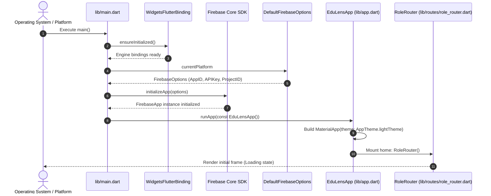
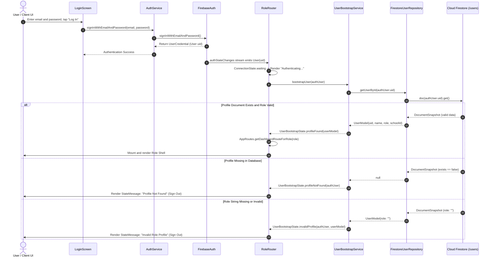
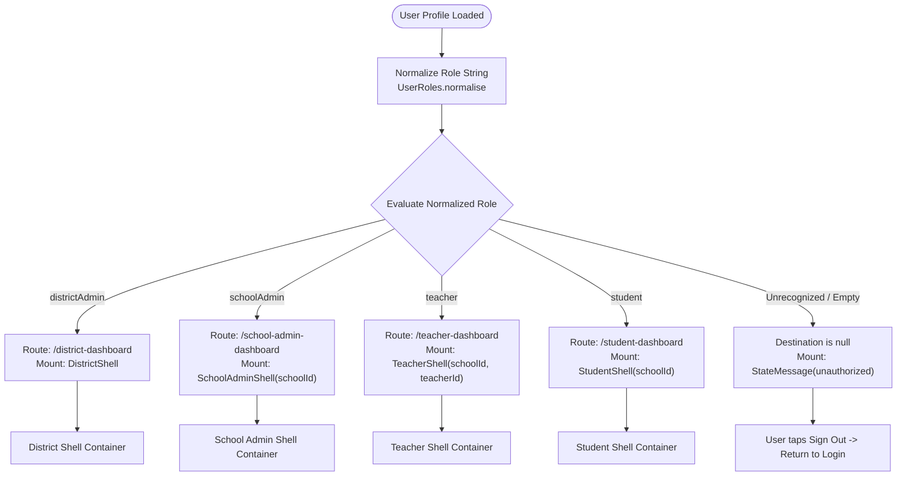
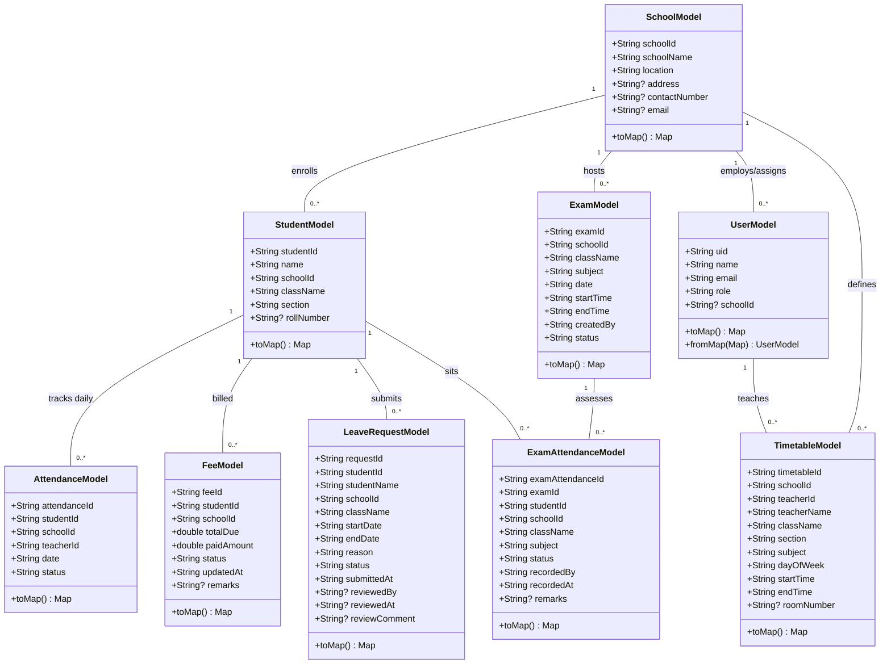
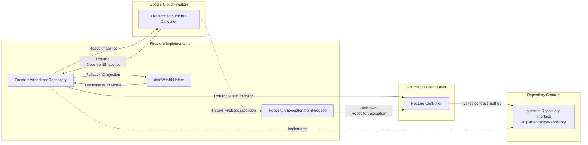
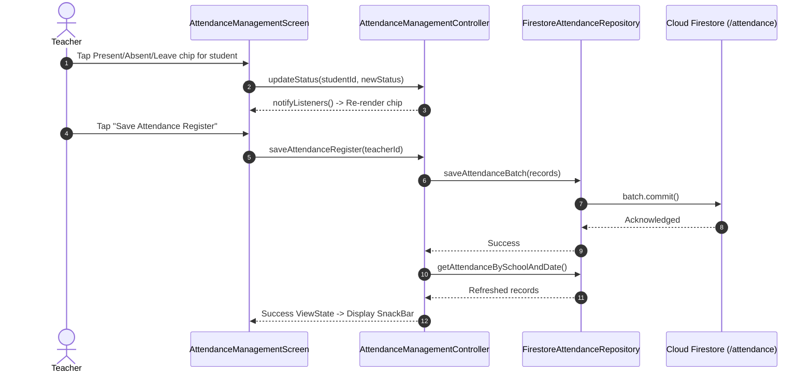
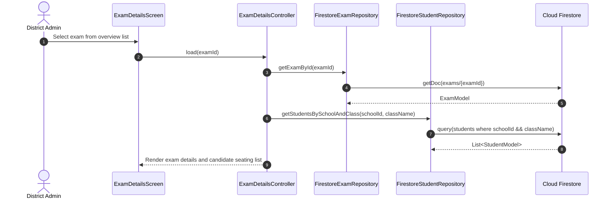

# EduLens — Low-Level Design (LLD) Document

---

## Document Control

| Property | Value |
| :--- | :--- |
| **Product Name** | EduLens |
| **Document Title** | Detailed Low-Level Design (LLD) Document |
| **System Category** | District & School Management System |
| **Document Version** | 1.0 (Post-MVP Implementation Baseline) |
| **Document Status** | Approved Technical Specification |
| **Repository URL** | `https://github.com/kalviumcommunity/SW2627_Flutter_EduLens_District_School_Management_System` |
| **Target Framework** | Flutter SDK (Dart `^3.13.4`) |
| **Persistence / Auth** | Google Cloud Firestore, Firebase Authentication |
| **Date of Preparation** | November 2026 |
| **Authors & Contributors** | Senior Flutter Engineer, Firebase Systems Architect, Lead Documentation Specialist |
| **Intended Technical Audience** | Flutter Engineers, Cloud Developers, QA Automation Engineers, Security Auditors |

### Document Revision History

| Version | Date | Author | Description of Architectural Changes |
| :--- | :--- | :--- | :--- |
| **1.0** | November 2026 | Core Engineering Team | Comprehensive low-level design document detailing class definitions, method signatures, serialization rules, state machines, repository queries, error handling, security rules, and test inventory. |

---

## Table of Contents

- [Document Control](#document-control)
- [1. Introduction](#1-introduction)
  - [1.1 Purpose](#11-purpose)
  - [1.2 Scope](#12-scope)
  - [1.3 Intended Technical Audience](#13-intended-technical-audience)
  - [1.4 Relationship to PRD and HLD](#14-relationship-to-prd-and-hld)
- [2. Detailed Project Structure](#2-detailed-project-structure)
- [3. Application Initialization](#3-application-initialization)
  - [3.1 Bootstrap Pipeline](#31-bootstrap-pipeline)
  - [3.2 Application Initialization Sequence Diagram](#32-application-initialization-sequence-diagram)
- [4. Authentication and User Bootstrap Implementation](#4-authentication-and-user-bootstrap-implementation)
  - [4.1 Detailed Class Specifications](#41-detailed-class-specifications)
  - [4.2 Login and Bootstrap State Transition Workflow](#42-login-and-bootstrap-state-transition-workflow)
  - [4.3 Login & User Bootstrap Sequence Diagram](#43-login--user-bootstrap-sequence-diagram)
- [5. Routing Implementation](#5-routing-implementation)
  - [5.1 Routing Architecture & Components](#51-routing-architecture--components)
  - [5.2 Role Normalization and Routing Table](#52-role-normalization-and-routing-table)
  - [5.3 Role Routing Flow Diagram](#53-role-routing-flow-diagram)
- [6. Model Design](#6-model-design)
  - [6.1 UserModel](#61-usermodel)
  - [6.2 SchoolModel](#62-schoolmodel)
  - [6.3 StudentModel](#63-studentmodel)
  - [6.4 AttendanceModel](#64-attendancemodel)
  - [6.5 FeeModel](#65-feemodel)
  - [6.6 ExamModel](#66-exammodel)
  - [6.7 ExamAttendanceModel](#67-examattendancemodel)
  - [6.8 LeaveRequestModel](#68-leaverequestmodel)
  - [6.9 TimetableModel](#69-timetablemodel)
  - [6.10 Model-to-Collection Summary & Relationships](#610-model-to-collection-summary--relationships)
  - [6.11 Core Model Relationships Diagram](#611-core-model-relationships-diagram)
- [7. Repository Layer Design](#7-repository-layer-design)
  - [7.1 UserRepository & FirestoreUserRepository](#71-userrepository--firestoreuserrepository)
  - [7.2 SchoolRepository & FirestoreSchoolRepository](#72-schoolrepository--firestoreschoolrepository)
  - [7.3 StudentRepository & FirestoreStudentRepository](#73-studentrepository--firestorestudentrepository)
  - [7.4 AttendanceRepository & FirestoreAttendanceRepository](#74-attendancerepository--firestoreattendancerepository)
  - [7.5 FeeRepository & FirestoreFeeRepository](#75-feerepository--firestorefeerepository)
  - [7.6 ExamRepository & FirestoreExamRepository](#76-examrepository--firestoreexamrepository)
  - [7.7 TimetableRepository & FirestoreTimetableRepository](#77-timetablerepository--firestoretimetablerepository)
  - [7.8 ExamAttendanceRepository & FirestoreExamAttendanceRepository](#78-examattendancerepository--firestoreexamattendancerepository)
  - [7.9 LeaveRequestRepository & FirestoreLeaveRequestRepository](#79-leaverequestrepository--firestoreleaverequestrepository)
  - [7.10 Repository Data Flow Diagram](#710-repository-data-flow-diagram)
- [8. Feature-by-Feature Implementation](#8-feature-by-feature-implementation)
  - [8.1 Authentication Feature](#81-authentication-feature)
  - [8.2 District Administration Feature](#82-district-administration-feature)
  - [8.3 School Administration Feature](#83-school-administration-feature)
  - [8.4 Teacher Workflows Feature](#84-teacher-workflows-feature)
  - [8.5 Student Workflows Feature](#85-student-workflows-feature)
  - [8.6 Feature Execution Flow Diagrams](#86-feature-execution-flow-diagrams)
- [9. Business Logic and Calculations](#9-business-logic-and-calculations)
  - [9.1 Metrics Engine Specifications](#91-metrics-engine-specifications)
  - [9.2 Date and Time Calculations (`AppDate`)](#92-date-and-time-calculations-appdate)
  - [9.3 Numerical Metric Verification Examples](#93-numerical-metric-verification-examples)
- [10. Firestore Database Design](#10-firestore-database-design)
  - [10.1 Data Dictionary Table](#101-data-dictionary-table)
  - [10.2 Collection Specifications & Access Patterns](#102-collection-specifications--access-patterns)
- [11. Firestore Security Rules — Implementation Detail](#11-firestore-security-rules--implementation-detail)
  - [11.1 Helper Functions Architecture](#111-helper-functions-architecture)
  - [11.2 Collection Permission Deep-Dive](#112-collection-permission-deep-dive)
  - [11.3 Context Differences: `resource.data` vs. `request.resource.data`](#113-context-differences-resourcedata-vs-requestresourcedata)
  - [11.4 Security Verification Status & Deployment Discrepancies](#114-security-verification-status--deployment-discrepancies)
- [12. Error Handling and State Management](#12-error-handling-and-state-management)
  - [12.1 ViewState Lifecycle](#121-viewstate-lifecycle)
  - [12.2 Repository Exception Mapping](#122-repository-exception-mapping)
  - [12.3 Safe UI State Updates (`SafeNotifier`)](#123-safe-ui-state-updates-safenotifier)
- [13. Async Programming and Lifecycle](#13-async-programming-and-lifecycle)
- [14. Testing Implementation](#14-testing-implementation)
  - [14.1 Comprehensive Test Inventory](#141-comprehensive-test-inventory)
  - [14.2 Test Suite Categorization & Verification Boundaries](#142-test-suite-categorization--verification-boundaries)
- [15. Demo Data and Seeder Tool](#15-demo-data-and-seeder-tool)
  - [15.1 Seeder Architecture & Execution](#151-seeder-architecture--execution)
  - [15.2 Seeded Domain Relationships](#152-seeded-domain-relationships)
- [16. Dependency and Configuration Details](#16-dependency-and-configuration-details)
- [17. Important Implementation Constraints and Known Issues](#17-important-implementation-constraints-and-known-issues)
- [18. File-to-Feature Traceability Matrix](#18-file-to-feature-traceability-matrix)
- [19. Glossary and References](#19-glossary-and-references)

---

## 1. Introduction

### 1.1 Purpose
This Low-Level Design (LLD) document provides an exhaustive, code-grounded technical specification of the **EduLens District & School Management System**. It documents the exact class structures, method signatures, asynchronous execution lifecycles, database access queries, error translation mechanisms, and security rules implemented within the repository.

### 1.2 Scope
This document covers all source code under `lib/`, the authorization logic in `firestore.rules`, database schema definitions, configuration manifests (`pubspec.yaml`, `firebase.json`), test harnesses under `test/`, and the developer seeding utility under `tool/`.

### 1.3 Intended Technical Audience
- **Flutter Engineers**: Implementing, extending, or maintaining screen widgets, controllers, and state lifecycles.
- **Backend / Firebase Developers**: Inspecting collection structures, query indexes, and security rule validations.
- **QA Automation Engineers**: Maintaining unit, widget, and integration test suites using in-memory fakes.
- **Security Auditors**: Auditing server-side access control boundaries and client-to-database communication.

### 1.4 Relationship to PRD and HLD
- **PRD (`docs/PRD.md`)**: Defines business requirements, personas, functional requirements (FR-001–FR-032), and acceptance criteria.
- **HLD (`docs/HLD.md`)**: Defines macro-architectural layers, system context, component topology, and high-level ADRs.
- **LLD (`docs/LLD.md`)** *(this document)*: Specifies the exact implementation: classes, fields, signatures, Firestore query paths, rules helper code, and error transformations.

---

## 2. Detailed Project Structure

The EduLens codebase follows a modular, feature-oriented structure with explicit separation between domain models, data access repositories, business logic controllers, and presentation widgets:

```text
c:\Users\harsh\Desktop\SW2627_Flutter_EduLens_District_School_Management_System
├── android/                             # Android platform runner, Gradle configs, google-services.json
├── docs/                                # Project documentation, PRD, HLD, LLD, and historical reports
│   ├── DATA_MODEL_GAP_REPORT.md         # Day 5 data-model gap analysis and metric decision log
│   ├── DAY12_INTEGRATION_REPORT.md      # Integration and rules emulator verification report
│   ├── HLD.md                           # Comprehensive High-Level Design document
│   ├── LLD.md                           # Detailed Low-Level Design document (this file)
│   ├── MVP_ACCEPTANCE_AUDIT.md          # Acceptance audit report and readiness sign-off
│   └── PRD.md                           # Comprehensive Product Requirements Document
├── ios/                                 # iOS platform runner and CocoaPods configuration
├── lib/                                 # Core application source code
│   ├── app.dart                         # EduLensApp root widget, MaterialApp, theme binding
│   ├── firebase_options.dart            # FlutterFire auto-generated platform options
│   ├── main.dart                        # Application bootstrap entrypoint
│   ├── core/                            # Shared utilities, theme, widgets, and state primitives
│   │   ├── constants/
│   │   │   ├── app_colors.dart          # Canonical color palette constants
│   │   │   ├── app_dimensions.dart      # Spacing, padding, and corner radius constants
│   │   │   └── firestore_collections.dart# Collection names, query field keys, role constants
│   │   ├── state/
│   │   │   ├── safe_notifier.dart       # SafeNotifier mixin protecting disposed controllers
│   │   │   └── view_state.dart          # Generic ViewState<T> (loading, ready, empty, error)
│   │   ├── theme/
│   │   │   ├── app_colors.dart          # Semantic UI theme colors
│   │   │   ├── app_spacing.dart         # Standardized padding and layout metrics
│   │   │   ├── app_text_styles.dart     # Typography styles (screenTitle, cardTitle, etc.)
│   │   │   └── app_theme.dart           # ThemeData builder for light theme
│   │   ├── utils/
│   │   │   ├── app_date.dart            # Parsing, formatting, and comparing ISO date/time strings
│   │   │   └── metrics.dart             # Mathematical metric formulas and categorical breakdowns
│   │   └── widgets/
│   │       ├── app_button.dart          # Primary, secondary, and loading action buttons
│   │       ├── app_card.dart            # Styled surface card container
│   │       ├── app_list_tile.dart       # Reusable leading-icon list tile
│   │       ├── app_screen_bar.dart      # Standardized AppBar header with logout action
│   │       ├── app_shell.dart           # Bottom navigation scaffold container
│   │       ├── app_text_field.dart      # Styled form text input with validation support
│   │       ├── placeholder_destination.dart# Fallback route destination view
│   │       ├── profile_logout_section.dart # Shared profile details and session termination modal
│   │       ├── stat_card.dart           # KPI metric card with icon badge
│   │       ├── state_message.dart       # Full-screen state feedback (loading, error, unauthorized)
│   │       ├── status_badge.dart        # Small pill badge for status display
│   │       ├── status_chip.dart         # Interactive or static status selection chip
│   │       └── view_state_builder.dart  # Reactive widget builder mapping ViewState to UI
│   ├── features/                        # Role-specific and authentication feature slices
│   │   ├── auth/
│   │   │   └── screens/
│   │   │       ├── forgot_password_screen.dart # Password reset link request form
│   │   │       ├── login_screen.dart           # Email/password authentication form
│   │   │       └── reset_password_screen.dart  # Client-side new password entry form
│   │   ├── district/
│   │   │   ├── controllers/
│   │   │   │   ├── district_dashboard_controller.dart # Drives macro KPI dashboard
│   │   │   │   ├── district_data_loader.dart          # Batch queries across collections
│   │   │   │   ├── exam_details_controller.dart       # Drives exam seating and candidate roster
│   │   │   │   ├── exam_overview_controller.dart      # Drives district exam calendar
│   │   │   │   ├── school_details_controller.dart     # Drives individual school audit view
│   │   │   │   └── school_list_controller.dart        # Drives school directory and search
│   │   │   ├── models/
│   │   │   │   └── school_summary.dart                # Presentation model for school directory cards
│   │   │   ├── screens/
│   │   │   │   ├── district_dashboard_screen.dart     # District executive dashboard view
│   │   │   │   ├── district_exam_overview_screen.dart # District-wide exam schedule view
│   │   │   │   ├── district_shell.dart                # District admin bottom navigation container
│   │   │   │   ├── exam_details_screen.dart           # Exam candidate allocation roster view
│   │   │   │   ├── school_details_screen.dart         # School audit and metric breakdown view
│   │   │   │   └── school_list_screen.dart            # Multi-school searchable directory view
│   │   │   └── widgets/
│   │   │       ├── exam_info_row.dart                 # Metadata row widget for exam details
│   │   │       └── exam_list_tile.dart                # Card tile for exam list display
│   │   ├── school_admin/
│   │   │   ├── controllers/
│   │   │   │   ├── school_admin_dashboard_controller.dart # Drives institutional school dashboard
│   │   │   │   ├── school_exam_schedule_controller.dart   # Drives school exam management
│   │   │   │   ├── school_info_controller.dart            # Drives school contact editing
│   │   │   │   └── student_fee_management_controller.dart # Drives student roster & fee updates
│   │   │   └── screens/
│   │   │       ├── school_admin_dashboard_screen.dart     # School overview dashboard
│   │   │       ├── school_admin_shell.dart                # School admin navigation container
│   │   │       ├── school_exam_schedule_screen.dart       # School exam timetable & creation view
│   │   │       ├── school_info_screen.dart                # School contact details editor
│   │   │       └── student_fee_management_screen.dart     # Student roster & fee modal view
│   │   ├── student/
│   │   │   ├── controllers/
│   │   │   │   ├── student_dashboard_controller.dart      # Drives student personal dashboard
│   │   │   │   └── student_leave_request_controller.dart  # Drives leave submission & history
│   │   │   ├── screens/
│   │   │   │   ├── student_dashboard_screen.dart          # Student personal academic view
│   │   │   │   └── student_shell.dart                     # Student navigation container
│   │   │   └── widgets/
│   │   │       └── submit_leave_request_dialog.dart       # Modal dialog for leave application
│   │   └── teacher/
│   │       ├── controllers/
│   │       │   ├── attendance_management_controller.dart  # Drives daily attendance taking
│   │       │   ├── teacher_dashboard_controller.dart      # Drives teacher home & today's classes
│   │       │   ├── teacher_leave_review_controller.dart   # Drives leave approval/rejection
│   │       │   └── teacher_timetable_controller.dart      # Drives weekly timetable display
│   │       └── screens/
│   │           ├── attendance_management_screen.dart      # Daily attendance register view
│   │           ├── teacher_home_screen.dart               # Teacher home dashboard view
│   │           ├── teacher_leave_review_screen.dart       # Student leave review view
│   │           ├── teacher_shell.dart                     # Teacher navigation container
│   │           └── teacher_timetable_screen.dart          # Weekly schedule period grid view
│   ├── models/                          # Pure Dart serialization data classes
│   │   ├── attendance_model.dart        # Daily classroom attendance record
│   │   ├── exam_attendance_model.dart   # Exam-specific candidate attendance record
│   │   ├── exam_model.dart              # Examination schedule entry
│   │   ├── fee_model.dart               # Student fee assessment and payment record
│   │   ├── leave_request_model.dart     # Student academic leave request record
│   │   ├── school_model.dart            # Institutional school record
│   │   ├── student_model.dart           # Enrolled student record
│   │   ├── timetable_model.dart         # Class schedule period entry
│   │   └── user_model.dart              # User profile and role document
│   ├── repositories/                    # Data contracts and Firestore adapters
│   │   ├── attendance_repository.dart
│   │   ├── exam_attendance_repository.dart
│   │   ├── exam_repository.dart
│   │   ├── fee_repository.dart
│   │   ├── firestore_attendance_repository.dart
│   │   ├── firestore_document_mapper.dart       # dataWithId document ID fallback helper
│   │   ├── firestore_exam_attendance_repository.dart
│   │   ├── firestore_exam_repository.dart
│   │   ├── firestore_fee_repository.dart
│   │   ├── firestore_leave_request_repository.dart
│   │   ├── firestore_school_repository.dart
│   │   ├── firestore_student_repository.dart
│   │   ├── firestore_timetable_repository.dart
│   │   ├── firestore_user_repository.dart
│   │   ├── leave_request_repository.dart
│   │   ├── repository_exception.dart            # Safe RepositoryException and error kinds
│   │   ├── school_repository.dart
│   │   ├── student_repository.dart
│   │   ├── timetable_repository.dart
│   │   └── user_repository.dart
│   ├── routes/
│   │   ├── app_routes.dart              # Static route strings and onGenerateRoute generator
│   │   └── role_router.dart             # Central auth & role resolution state machine
│   └── services/
│       ├── auth_service.dart            # Wrapper around FirebaseAuth with error mapping
│       └── user_bootstrap_service.dart  # Resolves and validates Firestore user profile
├── test/                                # Automated Dart test suite (41 test files, 313+ tests)
│   ├── support/
│   │   └── fake_repositories.dart       # Complete in-memory fake repository implementation
│   └── rules/                           # JavaScript Firestore Security Rules emulator harness
│       ├── freshness.mjs                # Data freshness latency benchmark script
│       ├── package.json                 # Node dependencies for @firebase/rules-unit-testing
│       └── rules.test.mjs               # 23 Security Rules runtime assertion tests
├── tool/
│   └── seed_firestore.dart              # Interactive multi-school demo data & account seeder
├── web/                                 # Web platform assets and HTML host template
├── firebase.json                        # Emulator and rules configuration
├── firestore.rules                      # Server-side Firestore authorization rules
└── pubspec.yaml                         # Dependencies, SDK constraints, and assets
```

---

## 3. Application Initialization

### 3.1 Bootstrap Pipeline
Application startup in `lib/main.dart` is asynchronous and executes before rendering the first frame:

```dart
// lib/main.dart
void main() async {
  WidgetsFlutterBinding.ensureInitialized();
  await Firebase.initializeApp(
    options: DefaultFirebaseOptions.currentPlatform,
  );
  runApp(const EduLensApp());
}
```

1. **`WidgetsFlutterBinding.ensureInitialized()`**: Ensures that the binary communication channels between Flutter and the host operating system (Android, iOS, or Web) are initialized before platform channels are invoked.
2. **`Firebase.initializeApp(...)`**: Reads the target platform's configuration constants from `DefaultFirebaseOptions.currentPlatform` (defined in `lib/firebase_options.dart`) and initializes the Firebase native C++/Java/Web core plugins.
3. **`EduLensApp` Execution**: Instantiates the root `StatelessWidget` defined in `lib/app.dart`.
4. **`MaterialApp` Configuration**:
   - `title`: `'EduLens'`
   - `debugShowCheckedModeBanner`: `false`
   - `theme`: `AppTheme.lightTheme` (configures primary color `#1E3A8A`, background `#F8FAFC`, card themes, input decorations, and typography)
   - `home`: `const RoleRouter()`
   - `onGenerateRoute`: `AppRoutes.onGenerateRoute`

### 3.2 Application Initialization Sequence Diagram



---

## 4. Authentication and User Bootstrap Implementation

### 4.1 Detailed Class Specifications

#### `AuthException` ([`lib/services/auth_service.dart`](file:///c:/Users/harsh/Desktop/SW2627_Flutter_EduLens_District_School_Management_System/lib/services/auth_service.dart))
- **Purpose**: Application-level exception shielding UI screens from raw Firebase SDK exceptions.
- **Fields**:
  - `final String message`: Clean, user-facing error description.
  - `final String? code`: Low-level Firebase error code string (e.g. `'wrong-password'`).
- **Methods**: `String toString() => message`.

#### `AuthService` ([`lib/services/auth_service.dart`](file:///c:/Users/harsh/Desktop/SW2627_Flutter_EduLens_District_School_Management_System/lib/services/auth_service.dart))
- **Purpose**: Encapsulates direct interaction with `FirebaseAuth`.
- **Fields**:
  - `final FirebaseAuth? _customFirebaseAuth`: Injected mock instance for testing.
  - `FirebaseAuth get _firebaseAuth`: Defaults to `FirebaseAuth.instance`.
- **Public Methods**:
  - `Stream<User?> get authStateChanges`: Emits current authenticated Firebase `User` or `null` if signed out.
  - `User? get currentUser`: Returns active Firebase `User` session.
  - `Future<UserCredential> signInWithEmailAndPassword({required String email, required String password})`: Authenticates credentials; throws `AuthException` on failure.
  - `Future<void> sendPasswordResetEmail({required String email})`: Requests out-of-band password reset link dispatch.
  - `Future<void> signOut()`: Invalidates active Firebase authentication session.
  - `static String _mapFirebaseAuthError(String code, String? defaultMessage)`: Maps codes (`'invalid-email'`, `'user-disabled'`, `'user-not-found'`, `'wrong-password'`, `'invalid-credential'`, `'too-many-requests'`) to safe user-facing prose.

#### `UserBootstrapStatus` ([`lib/services/user_bootstrap_service.dart`](file:///c:/Users/harsh/Desktop/SW2627_Flutter_EduLens_District_School_Management_System/lib/services/user_bootstrap_service.dart))
- **Purpose**: Enumerates the possible discrete outcomes of the user bootstrap sequence.
- **Values**: `unauthenticated`, `loading`, `profileFound`, `profileNotFound`, `invalidProfile`, `error`.

#### `UserBootstrapState` ([`lib/services/user_bootstrap_service.dart`](file:///c:/Users/harsh/Desktop/SW2627_Flutter_EduLens_District_School_Management_System/lib/services/user_bootstrap_service.dart))
- **Purpose**: Immutable value container emitted by `UserBootstrapService`.
- **Fields**:
  - `final UserBootstrapStatus status`
  - `final UserModel? userModel`
  - `final User? authUser`
  - `final String? errorMessage`
- **Named Constructors**:
  - `unauthenticated()`, `loading({User? authUser})`, `profileFound({required User authUser, required UserModel userModel})`, `profileNotFound({required User authUser})`, `invalidProfile({required User authUser, required UserModel userModel})`, `error(String message, {User? authUser})`.

#### `UserBootstrapService` ([`lib/services/user_bootstrap_service.dart`](file:///c:/Users/harsh/Desktop/SW2627_Flutter_EduLens_District_School_Management_System/lib/services/user_bootstrap_service.dart))
- **Purpose**: Resolves the signed-in user's domain profile from Cloud Firestore and validates role integrity.
- **Dependencies**: `AuthService`, `UserRepository`.
- **Public Method**:
  - `Future<UserBootstrapState> bootstrapUser([User? currentUser]) async`:
    1. Obtains `authUser = currentUser ?? _authService.currentUser`.
    2. If `authUser == null`, returns `UserBootstrapState.unauthenticated()`.
    3. Calls `userRepository.getUserById(authUser.uid)`.
    4. If result is `null`, returns `UserBootstrapState.profileNotFound(authUser: authUser)`.
    5. If `profile.role.trim().isEmpty || profile.uid.trim().isEmpty`, returns `UserBootstrapState.invalidProfile(...)`.
    6. Returns `UserBootstrapState.profileFound(authUser: authUser, userModel: profile)`.
    7. On uncaught exception, catches and returns `UserBootstrapState.error(...)`.

### 4.2 Login and Bootstrap State Transition Workflow

```text
[App Start / Auth Change]
         │
         ▼
Is authUser null?
  ├── YES ──► State: unauthenticated ──► Render LoginScreen
  └── NO  ──► State: loading ──────────► Render "Loading profile..."
                   │
                   ▼
       Query users/{uid} in Firestore
                   │
       ┌───────────┼───────────────────────┬────────────────────────┐
       ▼           ▼                       ▼                        ▼
  Doc is null?  Role or UID empty?   Query Threw Exception?   Profile Valid?
       │           │                       │                        │
       ▼           ▼                       ▼                        ▼
profileNotFound  invalidProfile          error                profileFound
       │           │                       │                        │
       ▼           ▼                       ▼                        ▼
StateMessage     StateMessage        StateMessage             Map role via
"Profile Not     "Invalid Role       "Profile Load            AppRoutes to
   Found"           Profile"             Error"                Role Shell:
(Sign Out btn)   (Sign Out btn)      (Retry btn)              - DistrictShell
                                                              - SchoolAdminShell
                                                              - TeacherShell
                                                              - StudentShell
```

### 4.3 Login & User Bootstrap Sequence Diagram



---

## 5. Routing Implementation

### 5.1 Routing Architecture & Components
Routing in EduLens is centralized across [`lib/routes/app_routes.dart`](file:///c:/Users/harsh/Desktop/SW2627_Flutter_EduLens_District_School_Management_System/lib/routes/app_routes.dart) and [`lib/routes/role_router.dart`](file:///c:/Users/harsh/Desktop/SW2627_Flutter_EduLens_District_School_Management_System/lib/routes/role_router.dart).

1. **Named Route Constants (`AppRoutes`)**:
   - `login`: `'/login'`
   - `forgotPassword`: `'/forgot-password'`
   - `resetPassword`: `'/reset-password'`
   - `districtDashboard`: `'/district-dashboard'`
   - `schoolDetails`: `'/school-details'` *(requires `schoolId` route argument)*
   - `examDetails`: `'/exam-details'` *(requires `examId` route argument)*
   - `schoolAdminDashboard`: `'/school-admin-dashboard'`
   - `teacherDashboard`: `'/teacher-dashboard'`
   - `studentDashboard`: `'/student-dashboard'`
   - `profile`: `'/profile'` *(placeholder route)*
2. **Dynamic Route Generation (`AppRoutes.onGenerateRoute`)**:
   - Intercepts parameterized routes (`/school-details`, `/exam-details`) before consulting static map.
   - For `/school-details`: validates `settings.arguments is String && settings.arguments.isNotEmpty`. Injects fresh repository instances into `SchoolDetailsController` and constructs `SchoolDetailsScreen`. If argument is missing, renders `_PlaceholderScreen(title: 'School Not Specified')`.
   - For `/exam-details`: validates `examId` string argument. Injects `ExamRepository`, `SchoolRepository`, and `StudentRepository` into `ExamDetailsController` and returns `ExamDetailsScreen`.
   - For unknown route names: renders `_PlaceholderScreen(title: 'Destination Not Found')`.
3. **Role Normalization (`UserRoles.normalise`)**:
   - Normalizes stored role strings by stripping underscores and converting to lowercase:
     ```dart
     // lib/core/constants/firestore_collections.dart
     static String normalise(String? role) {
       if (role == null) return '';
       switch (role.toLowerCase().replaceAll('_', '')) {
         case 'districtadmin': return districtAdmin;
         case 'schooladmin':   return schoolAdmin;
         case 'teacher':       return teacher;
         case 'student':       return student;
         default:              return '';
       }
     }
     ```

### 5.2 Role Normalization and Routing Table

| Stored Profile Role (`users.role`) | Normalized Token | Dashboard Route Name | Container Widget Shell Mounted | Injected Parameters |
| :--- | :--- | :--- | :--- | :--- |
| `'districtAdmin'`, `'district_admin'` | `districtAdmin` | `/district-dashboard` | `DistrictShell` | None |
| `'schoolAdmin'`, `'school_admin'` | `schoolAdmin` | `/school-admin-dashboard` | `SchoolAdminShell` | `schoolId`, `administratorName` |
| `'teacher'` | `teacher` | `/teacher-dashboard` | `TeacherShell` | `schoolId`, `teacherId` |
| `'student'` | `student` | `/student-dashboard` | `StudentShell` | `schoolId` |
| Any unassigned, empty, or other string | `''` (empty) | `null` | Render `StateMessage` error | None (offers sign-out action) |

### 5.3 Role Routing Flow Diagram



---

## 6. Model Design

All domain models are located under `lib/models/`. Each is an immutable value object with strongly-typed properties, map serialization, and `copyWith` support.

### 6.1 `UserModel` ([`lib/models/user_model.dart`](file:///c:/Users/harsh/Desktop/SW2627_Flutter_EduLens_District_School_Management_System/lib/models/user_model.dart))
- **Purpose**: Represents an authenticated user profile stored in `users/{uid}`.
- **Fields**:
  - `final String uid` (non-null)
  - `final String name` (non-null)
  - `final String email` (non-null)
  - `final String role` (non-null, normalized string)
  - `final String? schoolId` (nullable, optional for District Admin)
- **Serialization**:
  - `toMap()`: Serializes all 5 fields.
  - `fromMap(Map<String, dynamic> map)`: Safely casts strings with empty string defaults (`''`) for non-nullable properties.
- **Collection**: `users`. Keyed by Auth UID.
- **Tests**: [`test/models_test.dart`](file:///c:/Users/harsh/Desktop/SW2627_Flutter_EduLens_District_School_Management_System/test/models_test.dart).

### 6.2 `SchoolModel` ([`lib/models/school_model.dart`](file:///c:/Users/harsh/Desktop/SW2627_Flutter_EduLens_District_School_Management_System/lib/models/school_model.dart))
- **Purpose**: Represents an educational institution in `schools/{schoolId}`.
- **Fields**:
  - `final String schoolId` (non-null)
  - `final String schoolName` (non-null)
  - `final String location` (non-null)
  - `final String? address` (nullable, Day 5 extension)
  - `final String? contactNumber` (nullable, Day 5 extension)
  - `final String? email` (nullable, Day 5 extension)
- **Serialization**: `toMap()` and `fromMap()` preserve optional contact fields while providing empty string fallbacks for core identity fields.
- **Collection**: `schools`. Keyed by `schoolId`.
- **Tests**: [`test/models_test.dart`](file:///c:/Users/harsh/Desktop/SW2627_Flutter_EduLens_District_School_Management_System/test/models_test.dart).

### 6.3 `StudentModel` ([`lib/models/student_model.dart`](file:///c:/Users/harsh/Desktop/SW2627_Flutter_EduLens_District_School_Management_System/lib/models/student_model.dart))
- **Purpose**: Represents an enrolled student in `students/{studentId}`.
- **Fields**:
  - `final String studentId` (non-null)
  - `final String name` (non-null)
  - `final String schoolId` (non-null)
  - `final String className` (non-null)
  - `final String section` (non-null)
  - `final String? rollNumber` (nullable, Day 5 extension)
- **Serialization**: Standard `fromMap` handles legacy records lacking `rollNumber`.
- **Collection**: `students`. Keyed by `studentId`.

### 6.4 `AttendanceModel` ([`lib/models/attendance_model.dart`](file:///c:/Users/harsh/Desktop/SW2627_Flutter_EduLens_District_School_Management_System/lib/models/attendance_model.dart))
- **Purpose**: Represents a daily classroom attendance record in `attendance/{attendanceId}`.
- **Fields**:
  - `final String attendanceId` (non-null)
  - `final String studentId` (non-null)
  - `final String schoolId` (non-null)
  - `final String teacherId` (non-null)
  - `final String date` (non-null, string `yyyy-MM-dd`)
  - `final String status` (non-null, `'Present'`, `'Absent'`, or `'Leave'`)
- **Collection**: `attendance`. Keyed by `attendanceId`.

### 6.5 `FeeModel` ([`lib/models/fee_model.dart`](file:///c:/Users/harsh/Desktop/SW2627_Flutter_EduLens_District_School_Management_System/lib/models/fee_model.dart))
- **Purpose**: Represents student financial assessment and payment in `fees/{feeId}`.
- **Fields**:
  - `final String feeId` (non-null)
  - `final String studentId` (non-null)
  - `final String schoolId` (non-null)
  - `final double totalDue` (non-null, parsed from `num?` with `0.0` fallback)
  - `final double paidAmount` (non-null, parsed from `num?` with `0.0` fallback)
  - `final String status` (non-null, `'Paid'`, `'Partial'`, `'Outstanding'`)
  - `final String updatedAt` (non-null, ISO timestamp string)
  - `final String? remarks` (nullable, Day 5 extension)
- **Collection**: `fees`. Keyed by `feeId`.

### 6.6 `ExamModel` ([`lib/models/exam_model.dart`](file:///c:/Users/harsh/Desktop/SW2627_Flutter_EduLens_District_School_Management_System/lib/models/exam_model.dart))
- **Purpose**: Represents an academic examination schedule in `exams/{examId}`.
- **Fields**:
  - `final String examId` (non-null)
  - `final String schoolId` (non-null)
  - `final String className` (non-null)
  - `final String subject` (non-null)
  - `final String date` (non-null, string `yyyy-MM-dd`)
  - `final String startTime` (non-null, 24-hr `HH:mm`)
  - `final String endTime` (non-null, 24-hr `HH:mm`)
  - `final String createdBy` (non-null, teacher/admin UID)
  - `final String status` (default value `'Scheduled'`)
- **Collection**: `exams`. Keyed by `examId`.

### 6.7 `ExamAttendanceModel` ([`lib/models/exam_attendance_model.dart`](file:///c:/Users/harsh/Desktop/SW2627_Flutter_EduLens_District_School_Management_System/lib/models/exam_attendance_model.dart))
- **Purpose**: Represents candidate attendance for a specific exam in `examAttendance/{id}`. Distinct from daily attendance.
- **Fields**:
  - `final String examAttendanceId` (non-null)
  - `final String examId` (non-null)
  - `final String studentId` (non-null)
  - `final String schoolId` (non-null)
  - `final String className` (non-null)
  - `final String subject` (non-null)
  - `final String status` (default value `'Present'`, strictly `'Present'` or `'Absent'`)
  - `final String recordedBy` (non-null, invigilator UID)
  - `final String recordedAt` (non-null, ISO timestamp string)
  - `final String? remarks` (nullable)
- **Collection**: `examAttendance`. Keyed by `examAttendanceId`.

### 6.8 `LeaveRequestModel` ([`lib/models/leave_request_model.dart`](file:///c:/Users/harsh/Desktop/SW2627_Flutter_EduLens_District_School_Management_System/lib/models/leave_request_model.dart))
- **Purpose**: Represents student leave submission and review in `leaveRequests/{requestId}`.
- **Fields**:
  - `final String requestId` (non-null)
  - `final String studentId` (non-null)
  - `final String studentName` (non-null)
  - `final String schoolId` (non-null)
  - `final String className` (non-null)
  - `final String startDate` (non-null, `yyyy-MM-dd`)
  - `final String endDate` (non-null, `yyyy-MM-dd`)
  - `final String reason` (non-null)
  - `final String status` (default value `'Pending'`, strictly `'Pending'`, `'Approved'`, `'Rejected'`)
  - `final String submittedAt` (non-null, ISO timestamp string)
  - `final String? reviewedBy` (nullable, reviewer UID)
  - `final String? reviewedAt` (nullable, ISO timestamp string)
  - `final String? reviewComment` (nullable, review note)
- **Collection**: `leaveRequests`. Keyed by `requestId`.

### 6.9 `TimetableModel` ([`lib/models/timetable_model.dart`](file:///c:/Users/harsh/Desktop/SW2627_Flutter_EduLens_District_School_Management_System/lib/models/timetable_model.dart))
- **Purpose**: Represents a scheduled period in `timetables/{timetableId}`.
- **Fields**:
  - `final String timetableId` (non-null)
  - `final String schoolId` (non-null)
  - `final String teacherId` (non-null)
  - `final String teacherName` (non-null)
  - `final String className` (non-null)
  - `final String section` (non-null)
  - `final String subject` (non-null)
  - `final String dayOfWeek` (non-null, e.g. `'Monday'`)
  - `final String startTime` (non-null, 24-hr `HH:mm`)
  - `final String endTime` (non-null, 24-hr `HH:mm`)
  - `final String? roomNumber` (nullable, e.g. `'Room 101'`)
- **Collection**: `timetables`. Keyed by `timetableId`.

### 6.10 Model-to-Collection Summary & Relationships

| Model Class | Firestore Collection | Document ID Scheme | Nullable Fields | Defaulted Fields |
| :--- | :--- | :--- | :--- | :--- |
| `UserModel` | `users` | Auth UID (`uid`) | `schoolId` | None |
| `SchoolModel` | `schools` | `schoolId` | `address`, `contactNumber`, `email` | None |
| `StudentModel` | `students` | `studentId` | `rollNumber` | None |
| `AttendanceModel`| `attendance`| `attendanceId` | None | None |
| `FeeModel` | `fees` | `feeId` | `remarks` | `totalDue` (0.0), `paidAmount` (0.0) |
| `ExamModel` | `exams` | `examId` | None | `status` ('Scheduled') |
| `ExamAttendanceModel`| `examAttendance`| `examAttendanceId`| `remarks` | `status` ('Present') |
| `LeaveRequestModel`| `leaveRequests`| `requestId` | `reviewedBy`, `reviewedAt`, `reviewComment` | `status` ('Pending') |
| `TimetableModel`| `timetables`| `timetableId` | `roomNumber` | None |

### 6.11 Core Model Relationships Diagram



---

## 7. Repository Layer Design

The repository layer abstracts Cloud Firestore operations behind pure Dart interfaces. Every repository implementation maps raw `DocumentSnapshot` instances using `dataWithId()` and catches low-level `FirebaseException` errors, converting them into `RepositoryException`.

### 7.1 `UserRepository` & `FirestoreUserRepository`
- **Responsibility**: Manages user profile read and write operations.
- **Collection**: `FirestoreCollections.users` (`'users'`).
- **Methods**:
  - `Future<UserModel?> getUserById(String uid)`: Reads document at `users/{uid}`.
  - `Future<void> saveUser(UserModel user)`: Writes document via `.doc(user.uid).set(user.toMap(), SetOptions(merge: true))`.
  - `Future<List<UserModel>> getUsersBySchoolAndRole({required String schoolId, required String role})`: Queries `where('schoolId', isEqualTo: schoolId).where('role', isEqualTo: role)`. Backs teacher counts.
- **Tests**: [`test/repository_contracts_test.dart`](file:///c:/Users/harsh/Desktop/SW2627_Flutter_EduLens_District_School_Management_System/test/repository_contracts_test.dart).

### 7.2 `SchoolRepository` & `FirestoreSchoolRepository`
- **Responsibility**: Manages school campus directory entries.
- **Collection**: `FirestoreCollections.schools` (`'schools'`).
- **Methods**:
  - `Future<List<SchoolModel>> getSchools()`: Reads all documents in `schools/`.
  - `Future<SchoolModel?> getSchoolById(String schoolId)`: Reads document at `schools/{schoolId}`.
  - `Future<void> saveSchool(SchoolModel school)`: Writes document via `.doc(school.schoolId).set(school.toMap(), SetOptions(merge: true))`.
- **Tests**: [`test/repository_contracts_test.dart`](file:///c:/Users/harsh/Desktop/SW2627_Flutter_EduLens_District_School_Management_System/test/repository_contracts_test.dart).

### 7.3 `StudentRepository` & `FirestoreStudentRepository`
- **Responsibility**: Read-only contract for student roster access.
- **Collection**: `FirestoreCollections.students` (`'students'`).
- **Methods**:
  - `Future<List<StudentModel>> getStudentsBySchool(String schoolId)`: Queries `where('schoolId', isEqualTo: schoolId)`.
  - `Future<StudentModel?> getStudentById(String studentId)`: Reads document at `students/{studentId}`.
  - `Future<List<StudentModel>> getStudentsBySchoolAndClass({required String schoolId, required String className})`: Queries `where('schoolId', isEqualTo: schoolId).where('className', isEqualTo: className)`. Backs exam seating rosters.
- **Implementation Note**: Contract is deliberately read-only in client source; student creation in the current release is executed via seeding or administrative console.
- **Tests**: [`test/student_repository_test.dart`](file:///c:/Users/harsh/Desktop/SW2627_Flutter_EduLens_District_School_Management_System/test/student_repository_test.dart).

### 7.4 `AttendanceRepository` & `FirestoreAttendanceRepository`
- **Responsibility**: Daily classroom attendance persistence and queries.
- **Collection**: `FirestoreCollections.attendance` (`'attendance'`).
- **Methods**:
  - `Future<List<AttendanceModel>> getAttendanceBySchoolAndDate({required String schoolId, required String date})`: Queries `where('schoolId', isEqualTo: schoolId).where('date', isEqualTo: date)`.
  - `Future<List<AttendanceModel>> getAttendanceBySchool(String schoolId)`: Reads all records for school.
  - `Future<List<AttendanceModel>> getAttendanceByStudent(String studentId)`: Reads all records for student.
  - `Future<AttendanceModel?> getAttendanceByStudentAndDate({required String studentId, required String date})`: Single student record query.
  - `Future<void> saveAttendance(AttendanceModel attendance)`: Saves individual record.
  - `Future<void> saveAttendanceBatch(List<AttendanceModel> records)`: Initializes `WriteBatch`, sets each record on `_collection.doc(r.attendanceId)`, and executes atomic `batch.commit()`.
- **Tests**: [`test/attendance_management_test.dart`](file:///c:/Users/harsh/Desktop/SW2627_Flutter_EduLens_District_School_Management_System/test/attendance_management_test.dart).

### 7.5 `FeeRepository` & `FirestoreFeeRepository`
- **Responsibility**: Student fee balance retrieval and status modification.
- **Collection**: `FirestoreCollections.fees` (`'fees'`).
- **Methods**:
  - `Future<FeeModel?> getFeeByStudentId(String studentId)`: Queries `where('studentId', isEqualTo: studentId)`. Returns first matching or `null`.
  - `Future<List<FeeModel>> getFeesBySchool(String schoolId)`: Queries `where('schoolId', isEqualTo: schoolId)`.
  - `Future<void> updateFeeStatus(FeeModel fee)`: Writes update via `.doc(fee.feeId).set(fee.toMap(), SetOptions(merge: true))`.
- **Tests**: [`test/student_fee_management_test.dart`](file:///c:/Users/harsh/Desktop/SW2627_Flutter_EduLens_District_School_Management_System/test/student_fee_management_test.dart).

### 7.6 `ExamRepository` & `FirestoreExamRepository`
- **Responsibility**: Examination schedule creation and retrieval.
- **Collection**: `FirestoreCollections.exams` (`'exams'`).
- **Methods**:
  - `Future<List<ExamModel>> getExamsBySchool(String schoolId)`: Queries `where('schoolId', isEqualTo: schoolId)`.
  - `Future<List<ExamModel>> getExamsBySchoolAndClass({required String schoolId, required String className})`: Narrowed query.
  - `Future<List<ExamModel>> getAllExams()`: District-wide query reading all exams.
  - `Future<ExamModel?> getExamById(String examId)`: Reads single exam document.
  - `Future<void> saveExam(ExamModel exam)`: Writes exam record to `exams/{exam.examId}`.
- **Tests**: [`test/district_exams_test.dart`](file:///c:/Users/harsh/Desktop/SW2627_Flutter_EduLens_District_School_Management_System/test/district_exams_test.dart).

### 7.7 `TimetableRepository` & `FirestoreTimetableRepository`
- **Responsibility**: Weekly classroom period allocations.
- **Collection**: `'timetables'`.
- **Methods**:
  - `Future<List<TimetableModel>> getTimetableBySchool(String schoolId)`: School timetable query.
  - `Future<List<TimetableModel>> getTimetableByTeacher({required String schoolId, required String teacherId})`: Teacher schedule query.
  - `Future<List<TimetableModel>> getTimetableByTeacherAndDay({required String schoolId, required String teacherId, required String dayOfWeek})`: Day-scoped query backing "Today's Classes".
  - `Future<void> saveTimetableEntry(TimetableModel entry)`: Writes timetable entry.
  - `Future<void> deleteTimetableEntry(String timetableId)`: Deletes timetable entry.
- **Tests**: [`test/timetable_foundation_test.dart`](file:///c:/Users/harsh/Desktop/SW2627_Flutter_EduLens_District_School_Management_System/test/timetable_foundation_test.dart).

### 7.8 `ExamAttendanceRepository` & `FirestoreExamAttendanceRepository`
- **Responsibility**: Candidate attendance for examinations.
- **Collection**: `'examAttendance'`.
- **Methods**:
  - `Future<List<ExamAttendanceModel>> getExamAttendanceByExam({required String schoolId, required String examId})`: Exam candidate attendance query.
  - `Future<ExamAttendanceModel?> getExamAttendanceForStudent({required String schoolId, required String examId, required String studentId})`: Single candidate query.
  - `Future<List<ExamAttendanceModel>> getExamAttendanceByStudent({required String schoolId, required String studentId})`: Student history query.
  - `Future<void> saveExamAttendanceRecord(ExamAttendanceModel record)`: Saves single record.
  - `Future<void> saveExamAttendanceBatch(List<ExamAttendanceModel> records)`: Saves records in an atomic `WriteBatch`.
- **Tests**: [`test/exam_attendance_foundation_test.dart`](file:///c:/Users/harsh/Desktop/SW2627_Flutter_EduLens_District_School_Management_System/test/exam_attendance_foundation_test.dart).

### 7.9 `LeaveRequestRepository` & `FirestoreLeaveRequestRepository`
- **Responsibility**: Student leave application submission and teacher adjudication.
- **Collection**: `'leaveRequests'`.
- **Methods**:
  - `Future<List<LeaveRequestModel>> getLeaveRequestsByStudent(String studentId)`: Student history query.
  - `Future<List<LeaveRequestModel>> getLeaveRequestsBySchool(String schoolId)`: School-scoped pending requests query.
  - `Future<void> saveLeaveRequest(LeaveRequestModel request)`: Submits new leave request with `status: 'Pending'`.
  - `Future<void> updateLeaveRequestStatus({required String requestId, required String status, required String teacherId, String? comment})`: Updates `status`, `reviewedBy`, `reviewedAt`, and `reviewComment`.
- **Tests**: [`test/student_leave_request_test.dart`](file:///c:/Users/harsh/Desktop/SW2627_Flutter_EduLens_District_School_Management_System/test/student_leave_request_test.dart).

### 7.10 Repository Data Flow Diagram



---

## 8. Feature-by-Feature Implementation

### 8.1 Authentication Feature
- **Screen**: [`LoginScreen`](file:///c:/Users/harsh/Desktop/SW2627_Flutter_EduLens_District_School_Management_System/lib/features/auth/screens/login_screen.dart)
  - Manages internal state: `_isLoading`, `_rememberMe`, `_errorMessage`.
  - Form validation: `_formKey.currentState!.validate()`.
  - Controller/Service: Calls `AuthService.signInWithEmailAndPassword()`.
  - Bootstrap: Passes user to `UserBootstrapService.bootstrapUser()`.
  - Routing: On `profileFound`, maps role via `AppRoutes.getDashboardRouteForRole()` and navigates via `Navigator.pushReplacementNamed()`.
- **Screen**: [`ForgotPasswordScreen`](file:///c:/Users/harsh/Desktop/SW2627_Flutter_EduLens_District_School_Management_System/lib/features/auth/screens/forgot_password_screen.dart)
  - Calls `AuthService.sendPasswordResetEmail()`.
  - Renders success container banner upon completion.
- **Trace**: `LoginScreen` -> `AuthService` -> `FirebaseAuth` -> `UserBootstrapService` -> `FirestoreUserRepository` -> `users/{uid}`.

### 8.2 District Administration Feature
- **Screens**:
  - `DistrictDashboardScreen` (Driven by `DistrictDashboardController` & `DistrictDataLoader`).
  - `SchoolListScreen` (Driven by `SchoolListController`).
  - `SchoolDetailsScreen` (Driven by `SchoolDetailsController`).
  - `DistrictExamOverviewScreen` (Driven by `ExamOverviewController`).
  - `ExamDetailsScreen` (Driven by `ExamDetailsController`).
- **Data Orchestration (`DistrictDataLoader`)**:
  - Executes parallel queries:
    ```dart
    final schools = await schoolRepository.getSchools();
    final students = await Future.wait(schools.map((s) => studentRepository.getStudentsBySchool(s.schoolId)));
    final attendance = await Future.wait(schools.map((s) => attendanceRepository.getAttendanceBySchool(s.schoolId)));
    final fees = await Future.wait(schools.map((s) => feeRepository.getFeesBySchool(s.schoolId)));
    final exams = await examRepository.getAllExams();
    ```
- **Trace**: `DistrictDashboardScreen` -> `DistrictDashboardController` -> `DistrictDataLoader` -> `Metrics.attendancePercentage()` -> `schools/`, `students/`, `attendance/`, `fees/`, `exams/`.

### 8.3 School Administration Feature
- **Screens**:
  - `SchoolAdminDashboardScreen` (Driven by `SchoolAdminDashboardController`).
  - `SchoolInfoScreen` (Driven by `SchoolInfoController`).
  - `StudentFeeManagementScreen` (Driven by `StudentFeeManagementController`).
- **Overpayment Prevention Logic**:
  ```dart
  // lib/features/school_admin/screens/student_fee_management_screen.dart
  if (paidVal > totalDueVal) {
    setState(() => _paidError = 'Paid amount cannot exceed total due ($totalDueVal)');
    return;
  }
  ```
- **Trace**: `StudentFeeManagementScreen` -> `StudentFeeManagementController` -> `FeeRepository.updateFeeStatus()` -> `FeeModel` -> `fees/{feeId}`.

### 8.4 Teacher Workflows Feature
- **Screens**:
  - `TeacherHomeScreen` (Driven by `TeacherDashboardController`).
  - `AttendanceManagementScreen` (Driven by `AttendanceManagementController`).
  - `TeacherTimetableScreen` (Driven by `TeacherTimetableController`).
  - `TeacherLeaveReviewScreen` (Driven by `TeacherLeaveReviewController`).
  - `SchoolExamScheduleScreen` (Driven by `SchoolExamScheduleController`).
- **Trace (Daily Attendance)**: `AttendanceManagementScreen` -> `AttendanceManagementController` -> `AttendanceRepository.saveAttendanceBatch()` -> `WriteBatch.commit()` -> `attendance/{id}`.

### 8.5 Student Workflows Feature
- **Screens**:
  - `StudentDashboardScreen` (Driven by `StudentDashboardController`).
  - `SchoolExamScheduleScreen` (Read-only, `allowScheduling: false`).
  - `SubmitLeaveRequestDialog` (Driven by `StudentLeaveRequestController`).
- **Trace (Leave Submission)**: `SubmitLeaveRequestDialog` -> `StudentLeaveRequestController` -> `LeaveRequestRepository.saveLeaveRequest()` -> `LeaveRequestModel(status: 'Pending')` -> `leaveRequests/{id}`.

### 8.6 Feature Execution Flow Diagrams

#### A. Classroom Attendance Batch Write Flow


#### B. Examination Retrieval & Seating Roster Flow


---

## 9. Business Logic and Calculations

### 9.1 Metrics Engine Specifications ([`lib/core/utils/metrics.dart`](file:///c:/Users/harsh/Desktop/SW2627_Flutter_EduLens_District_School_Management_System/lib/core/utils/metrics.dart))

All mathematical derivations are centralized in the `Metrics` utility class. Formulas are strictly computed from source records rather than stored as counters:

#### 1. Attendance Percentage
- **Formula**:
  $$\text{Attendance Rate} = \left( \frac{\text{Count of records with } \text{status.toLowerCase()} == \text{'present'}}{\text{Total records in scope}} \right) \times 100$$
- **Boundary Rules**:
  - Anything not `'present'` counts towards the denominator (`Absent` and `Leave`).
  - If records list is empty, returns `null` (never `0.0`). Rendered as em dash (`"—"`).

#### 2. Attendance Status Breakdown
- Counts records matching case-insensitively into:
  - `present`: count where `status.toLowerCase() == 'present'`
  - `absent`: count where `status.toLowerCase() == 'absent'`
  - `leave`: count where `status.toLowerCase() == 'leave'`
- Malformed status strings are omitted from all three counts rather than assumed absent.

#### 3. Attention Threshold
- `static const double attentionThreshold = 70.0;`
- Triggered strictly when `percentage < 70.0`. Exactly `70.0%` is acceptable; `69.9%` triggers alert.

#### 4. Amount-Weighted Fee Paid Percentage
- **Formula**:
  $$\text{Fee Collection Rate} = \left( \frac{\sum \text{paidAmount}}{\sum \text{totalDue}} \right) \times 100$$
- **Boundary Rules**:
  - Clamped between `0.0` and `100.0`.
  - If $\sum \text{totalDue} \le 0$ or fees list is empty, returns `null` (renders as `"—"`).

#### 5. Fee Breakdown
- Counts fee documents by nominal `status` string into `paid`, `partial`, and `outstanding`.

#### 6. Upcoming Exams Filtering
- `upcomingExams(exams, from: date)`: Filters `AppDate.isOnOrAfter(e.date, from)` and sorts lexicographically by `date`.
- `examsWithinDays(exams, from: date, days: 7)`: Filters `AppDate.isWithinDays(e.date, from, days)` and sorts chronologically.

### 9.2 Date and Time Calculations ([`lib/core/utils/app_date.dart`](file:///c:/Users/harsh/Desktop/SW2627_Flutter_EduLens_District_School_Management_System/lib/core/utils/app_date.dart))
- **`tryParse(String? value)`**: Parses `yyyy-MM-dd` into midnight local `DateTime`. Returns `null` on malformed input without throwing.
- **`isOnOrAfter(String? value, DateTime from)`**: Evaluates calendar day comparison (`!date.isBefore(from)`).
- **`isWithinDays(String? value, DateTime from, int days)`**: Checks if date falls in interval $[ \text{from}, \text{from} + \text{days} ]$.
- **`formatTime(String? value)`**: Converts 24-hour `HH:mm` into 12-hour AM/PM format (e.g. `'09:05'` -> `'9:05 AM'`, `'14:30'` -> `'2:30 PM'`).

### 9.3 Numerical Metric Verification Examples

#### Example A: Attendance Calculation
Given 4 attendance records:
- Student 1: `'Present'`
- Student 2: `'Present'`
- Student 3: `'Absent'`
- Student 4: `'Leave'`

- Total records = 4
- Present count = 2
- Attendance Rate = $\frac{2}{4} \times 100 = 50.0\%$
- Attention Alert: $50.0\% < 70.0\% \implies$ **ALERT TRIGGERED (Warning Badge displayed)**.

#### Example B: Amount-Weighted Fee Calculation
Given 3 fee records:
- Student 1: Total Due = \$1000, Paid Amount = \$1000 (Status: Paid)
- Student 2: Total Due = \$1000, Paid Amount = \$500 (Status: Partial)
- Student 3: Total Due = \$1000, Paid Amount = \$0 (Status: Outstanding)

- $\sum \text{totalDue} = 1000 + 1000 + 1000 = \$3000$
- $\sum \text{paidAmount} = 1000 + 500 + 0 = \$1500$
- Fee Collection Rate = $\frac{1500}{3000} \times 100 = 50.0\%$
- Categorical Fee Breakdown: Paid = 1, Partial = 1, Outstanding = 1 (Total = 3).

---

## 10. Firestore Database Design

### 10.1 Data Dictionary Table

| Collection | Document ID Strategy | Mandatory Fields | Optional / Nullable Fields | Read Access Scope | Write Access Scope |
| :--- | :--- | :--- | :--- | :--- | :--- |
| **`users`** | Firebase Auth UID | `uid`, `name`, `email`, `role` | `schoolId` | District Admin, self, staff of same school | District Admin, self (registration) |
| **`schools`** | Unique `schoolId` (e.g. `school01`) | `schoolId`, `schoolName`, `location` | `address`, `contactNumber`, `email` | Authenticated users | District Admin (create/delete), School Admin (update contact) |
| **`students`** | Unique `studentId` (Auth UID for self) | `studentId`, `name`, `schoolId`, `className`, `section` | `rollNumber` | District Admin, school staff, self student | District Admin, School Admin of same school |
| **`attendance`** | `attendanceId` (e.g. `att_s1_st1_date`) | `attendanceId`, `studentId`, `schoolId`, `teacherId`, `date`, `status` | None | District Admin, school staff, self student | District Admin, Teacher of same school |
| **`fees`** | `feeId` (e.g. `fee_stu1`) | `feeId`, `studentId`, `schoolId`, `totalDue`, `paidAmount`, `status`, `updatedAt` | `remarks` | District Admin, school staff, self student | District Admin, School Admin of same school |
| **`exams`** | `examId` (e.g. `ex1`) | `examId`, `schoolId`, `className`, `subject`, `date`, `startTime`, `endTime`, `createdBy`, `status` | None | District Admin, staff & students of same school | District Admin, School Admin & Teacher of same school |
| **`examAttendance`**| `examAttendanceId` | `examAttendanceId`, `examId`, `studentId`, `schoolId`, `className`, `subject`, `status`, `recordedBy`, `recordedAt` | `remarks` | District Admin, school staff, self student | District Admin, School Admin & Teacher of same school |
| **`leaveRequests`**| `requestId` (e.g. `lr1`) | `requestId`, `studentId`, `studentName`, `schoolId`, `className`, `startDate`, `endDate`, `reason`, `status`, `submittedAt` | `reviewedBy`, `reviewedAt`, `reviewComment` | District Admin, school staff, self student | Student (create 'Pending'), School Admin & Teacher (review) |
| **`timetables`** | `timetableId` (e.g. `tt1`) | `timetableId`, `schoolId`, `teacherId`, `teacherName`, `className`, `section`, `subject`, `dayOfWeek`, `startTime`, `endTime` | `roomNumber` | District Admin, staff of same school | District Admin, School Admin & Teacher of same school |

### 10.2 Collection Specifications & Access Patterns
1. **Compound Index Requirements**:
   - `students`: `schoolId` + `className` (for exam seating allocations).
   - `attendance`: `schoolId` + `date` (for teacher daily registers).
   - `timetables`: `schoolId` + `teacherId` + `dayOfWeek` (for "Today's Classes").
   - `exams`: `schoolId` + `className` (for student class schedules).
2. **Document Partitioning**: No subcollections are utilized in the current design; a flat, root-level collection topology is maintained to facilitate cross-school district aggregation.

---

## 11. Firestore Security Rules — Implementation Detail

The system's authorization model is declared in [`firestore.rules`](file:///c:/Users/harsh/Desktop/SW2627_Flutter_EduLens_District_School_Management_System/firestore.rules).

### 11.1 Helper Functions Architecture
```javascript
// firestore.rules
function isSignedIn() { return request.auth != null; }

function hasUserProfile() {
  return isSignedIn() &&
    exists(/databases/$(database)/documents/users/$(request.auth.uid));
}

function getUserData() {
  return get(/databases/$(database)/documents/users/$(request.auth.uid)).data;
}

function getUserRole() {
  return hasUserProfile() ? getUserData().role : '';
}

function getUserSchoolId() {
  return hasUserProfile() && ('schoolId' in getUserData()) ? getUserData().schoolId : '';
}

function isDistrictAdmin() { return getUserRole() == 'districtAdmin'; }
function isSchoolAdmin(schoolId) { return getUserRole() == 'schoolAdmin' && getUserSchoolId() == schoolId; }
function isTeacher(schoolId) { return getUserRole() == 'teacher' && getUserSchoolId() == schoolId; }
function isStudent() { return getUserRole() == 'student'; }
```

### 11.2 Collection Permission Deep-Dive

#### 1. `users/{uid}`
- **Read**: `isDistrictAdmin() || request.auth.uid == uid || (!isStudent() && getUserSchoolId() == resource.data.schoolId)`.
- **Create**: District Admin, or self if `request.auth.uid == uid && request.resource.data.uid == uid`.
- **Update**: District Admin, or self preserving UID immutability.
- **Delete**: District Admin only.

#### 2. `schools/{schoolId}`
- **Read**: All authenticated users.
- **Create**: District Admin with valid schema.
- **Update**: District Admin, or School Admin matching `schoolId` where `schoolName` and `location` remain identical to `resource.data`.
- **Delete**: District Admin only.

#### 3. `students/{studentId}`
- **Read**: `isDistrictAdmin() || (!isStudent() && getUserSchoolId() == resource.data.schoolId) || (isStudent() && (resource.data.studentId == request.auth.uid || studentId == request.auth.uid))`.
- **Create / Update**: District Admin or School Admin of the school.
- **Delete**: District Admin only.

#### 4. `attendance/{attendanceId}`
- **Read**: District Admin, staff of same school, or student matching `resource.data.studentId == request.auth.uid`.
- **Create**: District Admin, or Teacher matching school and `teacherId == request.auth.uid`.
- **Update**: District Admin, or Teacher of school preserving `attendanceId`, `studentId`, `date`.
- **Delete**: District Admin only.

#### 5. `fees/{feeId}`
- **Read**: District Admin, staff of same school, or student matching `studentId == request.auth.uid`.
- **Create / Update**: District Admin or School Admin of target school.
- **Delete**: District Admin only.

#### 6. `exams/{examId}`
- **Read**: District Admin, or any user matching `getUserSchoolId() == resource.data.schoolId`.
- **Create / Update**: District Admin, or School Admin/Teacher of school where `createdBy == request.auth.uid`.
- **Delete**: District Admin or School Admin of school.

#### 7. `leaveRequests/{requestId}`
- **Read**: District Admin, student matching `studentId == request.auth.uid`, or school staff.
- **Create**: Student matching UID with `status == 'Pending'` and no reviewer fields injected.
- **Update**: School Admin or Teacher of school transitioning `status` from `'Pending'` to `'Approved'`/`'Rejected'`, writing `reviewedBy == request.auth.uid`, with immutable student fields.
- **Delete**: Prohibited for all users (`allow delete: if false;`).

#### 8. `timetables/{timetableId}`
- **Read**: District Admin or staff of same school.
- **Create / Update / Delete**: District Admin or School Admin/Teacher of school.

#### 9. `examAttendance/{examAttendanceId}`
- **Read**: District Admin, school staff, or candidate student.
- **Create / Update**: District Admin, or School Admin/Teacher of school where `recordedBy == request.auth.uid`.
- **Delete**: District Admin only.

### 11.3 Context Differences: `resource.data` vs. `request.resource.data`
- **`resource.data`**: The existing document currently stored in Cloud Firestore prior to write execution. Used in `read` rules and `update` preconditions to verify ownership.
- **`request.resource.data`**: The incoming document payload submitted by the client write. Used in `create` and `update` rules to validate schema integrity, type constraints, and field immutability.

### 11.4 Security Verification Status & Deployment Discrepancies

> [!CAUTION]
> - **Test Report Discrepancy**: `docs/DAY12_INTEGRATION_REPORT.md` records 23 passed tests against the Rules Emulator, while `docs/MVP_ACCEPTANCE_AUDIT.md` records rules tests as not executed due to a runner Java configuration issue.
> - **Deployment Status**: The Day 12 report explicitly notes that corrected rules were **not deployed** to the live Firebase project.
> - **Requirement**: Rules must be verified independently via `cd test/rules && npm test` and deployed via `firebase deploy --only firestore:rules` before production promotion.

---

## 12. Error Handling and State Management

### 12.1 ViewState Lifecycle
All UI screens consume states through [`ViewState<T>`](file:///c:/Users/harsh/Desktop/SW2627_Flutter_EduLens_District_School_Management_System/lib/core/state/view_state.dart):

```dart
// lib/core/state/view_state.dart
enum ViewStatus { loading, ready, empty, error }

class ViewState<T> {
  final ViewStatus status;
  final T? data;
  final String? message;
  final bool isUnauthorized;
  // Factory constructors: loading(), ready(T data), empty({String? message}), error(...)
}
```

- Handled in widgets via `ViewStateBuilder<T>`:
  - `status == ViewStatus.loading` -> Renders `StateMessage.loading()` or spinner.
  - `status == ViewStatus.empty` -> Renders `StateMessage.empty()` card.
  - `status == ViewStatus.error` -> Checks `isUnauthorized`; renders lock icon or failure alert with retry button (`onRetry`).
  - `status == ViewStatus.ready` -> Invokes `builder(context, data!)`.

### 12.2 Repository Exception Mapping
Low-level `FirebaseException` codes are shielded by `RepositoryException`:
- `'permission-denied'` -> `RepositoryErrorKind.permissionDenied` -> `"You do not have permission to {action}."`
- `'not-found'` -> `RepositoryErrorKind.notFound` -> `"We could not find what you asked for."`
- `'unavailable'`, `'deadline-exceeded'` -> `RepositoryErrorKind.unavailable` -> `"We could not reach the server. Check your connection and try again."`
- Unrecognized -> `RepositoryErrorKind.unknown` -> `"Something went wrong while trying to {action}."`

### 12.3 Safe UI State Updates (`SafeNotifier`)
Controllers mix in [`SafeNotifier`](file:///c:/Users/harsh/Desktop/SW2627_Flutter_EduLens_District_School_Management_System/lib/core/state/safe_notifier.dart):
```dart
mixin SafeNotifier on ChangeNotifier {
  bool _disposed = false;
  @override
  void dispose() {
    _disposed = true;
    super.dispose();
  }
  @override
  void notifyListeners() {
    if (!_disposed && hasListeners) {
      super.notifyListeners();
    }
  }
}
```
This guarantees that background asynchronous queries cannot trigger framework exceptions if the widget tree has unmounted.

---

## 13. Async Programming and Lifecycle

EduLens adheres to strict Dart asynchronous programming patterns:
1. **`async` / `await`**: Used across all controllers and repository implementations for linear readability and non-blocking I/O.
2. **`Future.wait`**: Utilized in `DistrictDataLoader` to execute multi-collection queries concurrently, optimizing startup time.
3. **`Stream` / `StreamBuilder`**: Employed in `RoleRouter` to reactively listen to `AuthService.authStateChanges`.
4. **`FutureBuilder`**: Employed in `RoleRouter` to await profile bootstrap resolution.
5. **Widget Lifecycle Synchronization**:
   - `initState()`: Controllers instantiated and initial data load dispatched.
   - `dispose()`: TextEditingControllers, AnimationControllers, and FeatureControllers explicitly disposed to free memory.
   - `setState()`: Confined strictly to view-layer presentation toggles (e.g. search query changes, tab switching).

---

## 14. Testing Implementation

### 14.1 Comprehensive Test Inventory

The repository contains 41 automated Dart test files in `test/`, plus the JavaScript rules emulator harness:

| Test File | Feature Area | Test Type | What It Verifies |
| :--- | :--- | :--- | :--- |
| `attendance_management_test.dart` | Teacher | Widget / Controller | Roster rendering, chip toggling, atomic batch persistence. |
| `auth_service_test.dart` | Auth | Unit | Exception translation, credential delegation. |
| `auth_ui_test.dart` | Auth | Widget | Login and forgot password forms, validation warnings. |
| `core_journeys_test.dart` | Cross-Role | Integration (Fakes) | Multi-role user navigation and workflow journeys. |
| `critical_bug_fixes_test.dart` | Core | Unit | Fixes for disposed controllers and state listeners. |
| `data_freshness_test.dart` | Core | Integration (Fakes) | Immediate UI re-read following write operations. |
| `demo_seeding_test.dart` | Tooling | Unit | Seeder structure, record counts, and relationships. |
| `district_dashboard_test.dart` | District Admin | Widget / Controller | KPI metrics calculation, attention threshold badge. |
| `district_exams_test.dart` | District Admin | Widget / Controller | Exam calendar, upcoming/all tab filtering. |
| `district_metrics_test.dart` | Core | Unit | Attendance %, amount-weighted fee %, attention threshold. |
| `exam_attendance_foundation_test.dart` | Exams | Unit / Repository | Serialization, scoped queries, duplicate prevention. |
| `exam_lifecycle_test.dart` | Exams | Unit | Default `'Scheduled'` status, backward compatibility. |
| `exam_time_display_test.dart` | Core | Unit | 24-hr `HH:mm` to 12-hr AM/PM conversion in `AppDate`. |
| `logout_test.dart` | Shared | Widget | Confirmation modal, sign-out, navigation stack purge. |
| `models_test.dart` | Core Models | Unit | `toMap`, `fromMap`, `copyWith` across all models. |
| `repository_contracts_test.dart` | Repositories | Unit / Contract | Method signatures, CRUD behaviors against fakes. |
| `repository_errors_test.dart` | Repositories | Unit | `RepositoryException.fromFirebase` error mappings. |
| `role_e2e_journeys_test.dart` | Multi-Role | E2E Integration | Full end-to-end user journeys across all 4 roles. |
| `role_profile_screens_test.dart` | Shared | Widget | Profile tile rendering across all 4 role shells. |
| `role_routing_test.dart` | Routing | Unit | Role string normalization and dashboard route mapping. |
| `role_shells_test.dart` | Shells | Widget | Shell tab navigation and AppScreenBar rendering. |
| `routing_test.dart` | Routing | Widget / Router | `RoleRouter` states (loading, missing profile, invalid). |
| `school_admin_dashboard_test.dart`| School Admin | Widget / Controller | School KPIs, low-attendance alert banner. |
| `school_browsing_test.dart` | District Admin | Widget / Controller | Multi-school directory, search filtering. |
| `school_details_contact_info_test.dart`| District Admin | Widget | School contact info card, address, phone, email. |
| `school_exam_schedule_test.dart` | School Admin | Widget / Controller | Exam creation dialog, form validation. |
| `school_info_test.dart` | School Admin | Widget / Controller | School contact editor, phone and email validation. |
| `security_integration_audit_test.dart`| Security | Integration (Fakes) | Tenant isolation, cross-school data restriction. |
| `shell_widgets_test.dart` | Core UI | Widget | `AppShell`, `AppScreenBar`, navigation rail/bar. |
| `student_dashboard_test.dart` | Student | Widget / Controller | Read-only attendance %, fee status, upcoming exams. |
| `student_exam_consistency_test.dart`| Student | Widget | Read-only exam view, absence of creation buttons. |
| `student_fee_management_test.dart`| School Admin | Widget / Controller | Student roster search, fee editing, overpayment block. |
| `student_leave_request_test.dart`| Student / Teacher | Unit / Controller | Submission date validation, teacher review status. |
| `student_repository_test.dart` | Student | Unit | Scoped queries by school and class. |
| `teacher_dashboard_and_attendance_test.dart`| Teacher | Widget / Controller | Today's classes, attendance navigation. |
| `teacher_timetable_ui_test.dart` | Teacher | Widget / Controller | Weekly timetable grid, weekday tab filtering. |
| `theme_test.dart` | Core Theme | Unit | Primary colors, font families, theme consistency. |
| `theme_widgets_test.dart` | Core Widgets | Widget | `AppCard`, `AppButton`, `StatCard`, `StatusBadge`. |
| `timetable_foundation_test.dart` | Teacher | Unit / Repository | Serialization, teacher and day query filters. |
| `user_bootstrap_test.dart` | Services | Unit / Service | Profile lookup, missing/invalid role handling. |
| `widget_test.dart` | App | Widget | Smoke test verifying root app bootstrap. |
| `test/rules/rules.test.mjs` | Security Rules | Integration (Emulator)| 23 assertion tests verifying `firestore.rules`. |
| `test/rules/freshness.mjs` | Reliability | Benchmark (Emulator) | Write-to-read latency freshness measurement. |

### 14.2 Test Suite Categorization & Verification Boundaries
1. **Dart VM Unit & Widget Tests (313 tests)**: Execute using `flutter test` against in-memory fakes (`test/support/fake_repositories.dart`). They test view states, formatting, and controller lifecycles without network I/O.
2. **Rules Emulator Tests (23 tests)**: Execute using `npm test` under `test/rules/` against the Firebase Emulator Suite (`localhost:8080`). They execute actual security rule AST evaluation.
3. **Verification Boundary**: Passing Flutter Dart tests does **not** prove that deployed Cloud Firestore security rules permit an operation.

---

## 15. Demo Data and Seeder Tool

### 15.1 Seeder Architecture & Execution ([`tool/seed_firestore.dart`](file:///c:/Users/harsh/Desktop/SW2627_Flutter_EduLens_District_School_Management_System/tool/seed_firestore.dart))
- **Purpose**: Creates an isolated, realistic multi-school demonstration dataset in a dedicated development Firebase project.
- **Execution Command**: `flutter run -t tool/seed_firestore.dart -d chrome`
- **Execution Order**:
  1. `_seedDistrictAdmin`: Creates Auth account and `users/{uid}` with `role: 'districtAdmin'`.
  2. `_seedSchools`: Populates 4 schools (`school01` Greenwood High, `school02` Riverside Public, `school03` Hilltop Academy, `school04` Oakridge International).
  3. `_seedSchoolAdmins`: Provisions School Admins mapped to each school.
  4. `_seedTeachers`: Provisions teachers across campuses.
  5. `_seedStudentsAndProfiles`: Provisions 100+ student Auth accounts, Firestore profiles, and matching `students` documents.
  6. `_seedAttendance`: Writes daily attendance records, intentionally calibrating some schools below 70% to trigger the attention threshold.
  7. `_seedFees`: Writes fee assessment records with Paid, Partial, and Outstanding statuses.
  8. `_seedExams`: Schedules midterm and final examinations.
  9. `_seedTimetables`: Schedules teacher period assignments.
  10. `_seedExamAttendance`: Populates candidate attendance for completed exams.
  11. `_seedLeaveRequests`: Generates student leave requests with Pending, Approved, and Rejected statuses.
  12. `_exportLocalManifest`: Outputs account credentials to local `demo_credentials.local.md` (gitignored).

---

## 16. Dependency and Configuration Details

### 16.1 `pubspec.yaml` Dependencies
- **SDK Constraint**: `sdk: ^3.13.4`
- **`firebase_core: ^4.15.0`**: Cloud platform bridge and initialization.
- **`firebase_auth: ^6.7.0`**: Identity service, user sessions, token renewal.
- **`cloud_firestore: ^6.10.0`**: Document database client SDK.
- **`cupertino_icons: ^1.0.8`**: Supporting asset icon font.
- **`flutter_lints: ^6.0.0`** (dev): Recommended static analysis rules.
- **`flutter_test`** (dev): Flutter widget testing framework.

### 16.2 Firebase Configuration Artifacts
- **`firebase.json`**: Configures `firestore.rules` path, sets Firestore emulator port to `8080`, disables emulator UI, enables `singleProjectMode`.
- **`lib/firebase_options.dart`**: Contains platform-specific `FirebaseOptions` mapping API keys, App IDs, and project identifier (`sw2627-s131-1-flutter-edulens`).

---

## 17. Important Implementation Constraints and Known Issues

1. **Firestore Rules Live Deployment**: The repository contains the hardened security rules in `firestore.rules`, but repository reports note that these were not deployed to the production Firebase project. Deployment remains a manual operational prerequisite.
2. **Rules Emulator Test Runner Dependency**: The JavaScript test suite in `test/rules/` requires Node.js and Java JRE/JDK 17+. The MVP Acceptance Audit recorded that local emulator tests could not run when Java was absent from the runner.
3. **Data Model Gap Report Reconciliation**: `docs/DATA_MODEL_GAP_REPORT.md` (authored on Day 5) marks Timetables, Exam Attendance, Leave Requests, and Exam Status as unresolved. In the current codebase, all four gaps are fully resolved in code.
4. **Student Creation UI**: In the current application release, the student repository is read-only; new student accounts must be provisioned administratively or seeded via `tool/seed_firestore.dart`.

---

## 18. File-to-Feature Traceability Matrix

| Feature Module | UI Screen (`lib/features/`) | Controller / Service (`lib/`) | Domain Model (`lib/models/`) | Repository (`lib/repositories/`) | Firestore Collection | Key Test Files (`test/`) |
| :--- | :--- | :--- | :--- | :--- | :--- | :--- |
| **Authentication** | `LoginScreen`, `ForgotPasswordScreen` | `AuthService`, `UserBootstrapService` | `UserModel` | `FirestoreUserRepository` | `users` | `auth_service_test.dart`, `auth_ui_test.dart` |
| **Role Routing** | `RoleRouter` | `UserBootstrapService`, `AppRoutes` | `UserModel` | `FirestoreUserRepository` | `users` | `role_routing_test.dart`, `routing_test.dart` |
| **District Dashboard**| `DistrictDashboardScreen` | `DistrictDashboardController`, `DistrictDataLoader` | `SchoolModel`, `AttendanceModel`, `FeeModel` | All Repositories | `schools`, `attendance`, `fees`, `exams` | `district_dashboard_test.dart`, `district_metrics_test.dart` |
| **School Directory** | `SchoolListScreen`, `SchoolDetailsScreen` | `SchoolListController`, `SchoolDetailsController` | `SchoolModel`, `SchoolSummary` | `FirestoreSchoolRepository` | `schools` | `school_browsing_test.dart`, `school_details_contact_info_test.dart` |
| **District Exams** | `DistrictExamOverviewScreen`, `ExamDetailsScreen` | `ExamOverviewController`, `ExamDetailsController` | `ExamModel`, `StudentModel` | `FirestoreExamRepository`, `FirestoreStudentRepository` | `exams`, `students` | `district_exams_test.dart` |
| **School Dashboard** | `SchoolAdminDashboardScreen` | `SchoolAdminDashboardController` | `SchoolModel`, `StudentModel`, `FeeModel` | `FirestoreSchoolRepository`, `FirestoreFeeRepository` | `schools`, `fees`, `students` | `school_admin_dashboard_test.dart` |
| **School Info Edit** | `SchoolInfoScreen` | `SchoolInfoController` | `SchoolModel` | `FirestoreSchoolRepository` | `schools` | `school_info_test.dart` |
| **Fee Management** | `StudentFeeManagementScreen` | `StudentFeeManagementController` | `StudentModel`, `FeeModel` | `FirestoreStudentRepository`, `FirestoreFeeRepository` | `students`, `fees` | `student_fee_management_test.dart` |
| **Teacher Home** | `TeacherHomeScreen` | `TeacherDashboardController` | `SchoolModel`, `TimetableModel`, `ExamModel`| `FirestoreTimetableRepository`, `FirestoreExamRepository` | `timetables`, `exams` | `teacher_dashboard_and_attendance_test.dart` |
| **Daily Attendance** | `AttendanceManagementScreen`| `AttendanceManagementController` | `StudentModel`, `AttendanceModel` | `FirestoreAttendanceRepository` | `attendance` | `attendance_management_test.dart` |
| **Timetable Grid** | `TeacherTimetableScreen` | `TeacherTimetableController` | `TimetableModel` | `FirestoreTimetableRepository` | `timetables` | `teacher_timetable_ui_test.dart`, `timetable_foundation_test.dart` |
| **Leave Review** | `TeacherLeaveReviewScreen` | `TeacherLeaveReviewController` | `LeaveRequestModel` | `FirestoreLeaveRequestRepository`| `leaveRequests` | `student_leave_request_test.dart` |
| **Student Dashboard**| `StudentDashboardScreen` | `StudentDashboardController` | `StudentModel`, `AttendanceModel`, `FeeModel` | `FirestoreAttendanceRepository`, `FirestoreFeeRepository` | `attendance`, `fees`, `exams` | `student_dashboard_test.dart` |
| **Student Exams** | `SchoolExamScheduleScreen(readOnly)`| `SchoolExamScheduleController` | `ExamModel` | `FirestoreExamRepository` | `exams` | `student_exam_consistency_test.dart` |
| **Leave Submission** | `SubmitLeaveRequestDialog` | `StudentLeaveRequestController` | `LeaveRequestModel` | `FirestoreLeaveRequestRepository`| `leaveRequests` | `student_leave_request_test.dart` |

---

## 19. Glossary and References

### 19.1 Technical Terms
- **`dataWithId`**: An internal mapper function ensuring a deserialized map always carries its Firestore document ID, falling back to `doc.id` if missing.
- **Direct-to-Database**: A software architecture where client applications communicate directly with managed cloud databases without an intermediate custom application server.
- **In-Memory Fakes**: Test doubles (`test/support/fake_repositories.dart`) implementing repository contracts in memory to test UI and controllers without live Firebase dependencies.
- **Role Shell**: The root navigation container (`DistrictShell`, `SchoolAdminShell`, `TeacherShell`, `StudentShell`) hosting bottom navigation tabs for a specific user role.
- **`SafeNotifier`**: A custom `ChangeNotifier` mixin that guards against calling `notifyListeners()` on disposed controllers.
- **`WriteBatch`**: A Firestore transaction primitive allowing up to 500 document write operations to commit atomically.

### 19.2 Related Documents & Source Code
- [`README.md`](file:///c:/Users/harsh/Desktop/SW2627_Flutter_EduLens_District_School_Management_System/README.md) — Project overview, technology stack, and getting started guide.
- [`docs/PRD.md`](file:///c:/Users/harsh/Desktop/SW2627_Flutter_EduLens_District_School_Management_System/docs/PRD.md) — Comprehensive Product Requirements Document.
- [`docs/HLD.md`](file:///c:/Users/harsh/Desktop/SW2627_Flutter_EduLens_District_School_Management_System/docs/HLD.md) — High-Level Design Document.
- [`docs/DATA_MODEL_GAP_REPORT.md`](file:///c:/Users/harsh/Desktop/SW2627_Flutter_EduLens_District_School_Management_System/docs/DATA_MODEL_GAP_REPORT.md) — Data model gap analysis and metric decision log.
- [`docs/DAY12_INTEGRATION_REPORT.md`](file:///c:/Users/harsh/Desktop/SW2627_Flutter_EduLens_District_School_Management_System/docs/DAY12_INTEGRATION_REPORT.md) — Integration and rules emulator verification report.
- [`docs/MVP_ACCEPTANCE_AUDIT.md`](file:///c:/Users/harsh/Desktop/SW2627_Flutter_EduLens_District_School_Management_System/docs/MVP_ACCEPTANCE_AUDIT.md) — Acceptance audit report and readiness sign-off.
- [`firestore.rules`](file:///c:/Users/harsh/Desktop/SW2627_Flutter_EduLens_District_School_Management_System/firestore.rules) — Source code for Cloud Firestore Security Rules.
